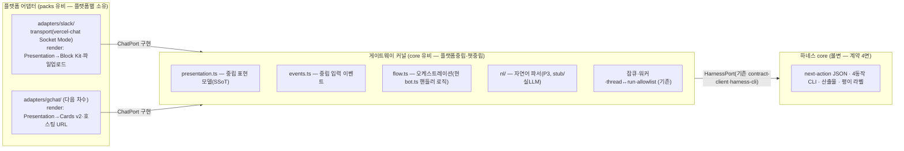

# 챗 게이트웨이 v2 — 헥사고날 재구조화 + 다안(md·이미지) 선택 + 자연어 이해

> **지위**: `docs/plans/`(진행 중 계획). **작성**: 2026-07-14 (사용자 대화 결정 반영).
> **관계**: 1차 구현 기록 = [`chat-layer-plan.md`](chat-layer-plan.md) — 그 문서의 로드맵 2차~5차를 **이 계획이 대체**한다.
> 규칙 SSoT = [`../../core/AGENTS.md`](../../core/AGENTS.md)(불변). core 무수정 원칙 유지.
> 실측 근거: 완주 런 `core/runs/ezderm-seam-e2e-0712/`(옵션 md 크기·키비주얼 PNG 구조) + 현행 `chat/src/` 코드.

---

## 0. 한 줄 정의

챗 레이어를 **플랫폼-중립 게이트웨이(커널) + 플랫폼 어댑터(Slack·GChat…)** 의 완전 분리 구조로 재정렬하고
(core↔packs 유비), 그 위에 **다안 보기·선택(스토리라인 md 전문 · 키비주얼 이미지) + 선택 감사 기록 +
자연어 이해**를 얹는다. 출하는 Slack 먼저, GChat 은 어댑터 추가만으로 붙는 상태를 만든다.

---

## 1. 잠긴 결정 (2026-07-14 사용자 확정 — 변경 시 재합의)

| # | 결정 | 근거·비고 |
|---|---|---|
| 1 | **완전 분리 구조**: 중립 기능(게이트웨이 커널) ↔ 플랫폼 어댑터, core/packs 유비 | 새 플랫폼 = 어댑터 폴더 추가 + 등록만. 커널 무수정 |
| 2 | **"공통분모(교집합)만 쓴다" 원칙(구 결정 7) 폐기** → **중립 기능 + 어댑터별 최적 매핑**으로 교체 | 교집합으로 UX 를 깎지 않는다. 기능 공백은 어댑터가 자기 방식으로 메꾼다(예: 이미지 — Slack=파일 업로드, GChat=호스팅 URL) |
| 3 | **출하는 Slack 먼저.** GChat 은 이번에 포트 계약·매핑표만 확정(구현은 다음 차수) | 사용자 결정("slack으로 하자") |
| 4 | **결과 위주 노출**: AI 사고과정·내부 용어·경로·JSON 은 현업에게 미노출(기존 결정 승계) | 생성은 백그라운드, 챗에는 산출물·선택지·판정만 |
| 5 | **게이트(승인·선택·RA)는 버튼만** — 자연어 "승인해줘"에는 버튼 카드를 다시 띄운다 | 감사·결정성(기존 잠긴 결정 승계) |
| 6 | **이해는 자연어, 방아쇠는 버튼**: NL 은 파싱·제안까지, 실행은 확인 카드 버튼 → 잡큐 → core 스크립트 | 오해석이 상태를 오염 못 하게 |
| 7 | **도메인 선언은 사람**: NL 은 명시 선언("화장품이야")만 추출, 없으면 묻는다. 내용 기반 추론 금지 | AGENTS 규칙 8 (AI 자동분류 없음) |
| 8 | **선택 기록 3겹 유지**: core `state.json` history(`--by chat:<플랫폼>:<user>`) + 단계 `decision.json` + 챗 스레드(1 스레드=1 run) | 실측 검증됨(4장) |
| 9 | **P4(S-1 생성 무인화)·P3-2(파일 인입 NL) 둘 다 범위 포함** | 2026-07-14 사용자 확정 |

---

## 2. 아키텍처 — 헥사고날 재정렬 (core/packs 유비)

### 2-1. 계층 그림



- **커널은 어떤 플랫폼도 모른다**(Slack/GChat 단어 금지). 어댑터는 하네스를 모른다(셸·경로·state 무지).
- **새 플랫폼 = `adapters/<플랫폼>/` 폴더 추가 + 레지스트리 등록만.** 커널 무수정 — packs 가 도메인을
  소유하고 core 로더가 조립하는 것과 동형.
- vercel/chat SDK 는 **Slack 어댑터의 내부 구현 세부로 강등**된다(전송·이벤트 배관·Block Kit 렌더).
  커널은 SDK 타입을 import 하지 않는다. GChat 어댑터가 나중에 무엇을 쓸지는 그 어댑터의 자유.

### 2-2. 포트 정의 (동결 — additive-only)

**ChatPort (커널→플랫폼, driven)** — 어댑터가 구현:

```ts
interface ChatPort {
  render(thread: ThreadRef, p: Presentation): Promise<void>;  // 중립 표현 → 플랫폼 네이티브
  subscribe(thread: ThreadRef): Promise<void>;
  capabilities(): CapabilityManifest;                          // 어댑터가 자기 매핑 방식 선언
}
```

**중립 표현 모델(Presentation)** — 커널이 소유하는 SSoT. 플랫폼 개념(블록·카드 규격) 0:

| Presentation | 뜻 | 실림 데이터 |
|---|---|---|
| `Setup` | 새 작업 설정 | 도메인·포맷 후보, 수집 상태 |
| `IngestPrompt` | 자료 요청 | 안내문, 스테이징 가능 여부 |
| `Progress` | 진행 상태 | 평이 라벨(passthrough) |
| `ApproveGate` | 단안 승인 | 요약 본문(md), RA 필요 여부 |
| `OptionSet` | **다안 md 선택**(P1) | 안별 `{key, 제목, 본문 md 전문, 추천 여부}` + 비교 md |
| `ImageOptionSet` | **다안 이미지 선택**(P2) | 안별 `{key, 이미지 파일경로[], 캡션}` + 추천 |
| `ConfirmGate` | 2단계 확정(비가역·RA) | 확인 문구, 대상 |
| `Verdict` | 심의 결과 | 🟢/🟠/🔴 + 평이 사유 |
| `NlProposal` | NL 이해 확인(P3) | 파싱 결과 요약 + 미확신 필드 질문 |
| `Done` | 완료 | 최종 산출물 목록 |

**중립 입력 이벤트(Event)** — 어댑터가 플랫폼 이벤트를 번역해 커널에 전달:
`MentionReceived · TextReply · ButtonPressed{action, payload, actor} · ChoiceMade{optionKey, actor}`.
actor 는 어댑터가 `chat:<플랫폼>:<user>` 로 정규화(감사 체인의 시작점).

**HarnessPort (커널→core)** — 기존 `contract-client.ts`·`harness-cli.ts` 그대로(계약 4면, 변경 없음).

### 2-3. 기능→플랫폼 매핑표 (어댑터가 소유)

| 중립 기능 | Slack 매핑(이번 구현) | GChat 매핑(설계만 — 다음 차수) |
|---|---|---|
| OptionSet(md 다안) | 안별 카드(md 전문→mrkdwn, ~1.5KB 라 통째 가능) + [이걸로] 버튼 + 추천 배지 | 안별 Card v2 + 버튼 |
| ImageOptionSet | **`files_upload_v2` 스레드 업로드**(네이티브·인프라 0) + 선택 버튼 카드 | **호스팅 URL 이미지 카드** — `ImageHost` 보조 포트(서명 단기 URL) 필요. 인프라(터널/프록시/클라우드)는 GChat 활성화 시 결정 |
| 자유 입력(제품명·WB·보완사유) | 스레드 답글 | 스레드 답글 |
| 2단계 확정(RA·키비주얼) | 확인 카드 재클릭 | 확인 카드 재클릭 |
| 진행/판정 | 카드 게시·수정 | 카드 게시·수정 |

> 원칙: 매핑 방식이 달라도 **커널이 보내는 Presentation 과 커널이 받는 Event 는 동일**하다.
> 감사 기록은 Event(actor)→잡큐→core 경로에서 남으므로 **표시 방식과 무관하게 항상 동일**(4장).

---

## 3. 재구조화 — 디렉터리·이동 계획 (P0)

```
chat/src/
  kernel/                  # ← 플랫폼중립 커널 (core 유비)
    presentation.ts        #   중립 표현 모델 (신규 — 현 ViewModel 확장)
    events.ts              #   중립 입력 이벤트 (신규)
    ports.ts               #   ChatPort·CapabilityManifest (신규)
    flow.ts                #   오케스트레이션 (현 bot.ts 의 handle* 로직 이동)
    nl/                    #   P3 자연어 파서 (stub/실LLM)
    job-queue.ts worker.ts viewmodel.ts thread-run-map.ts pending-input.ts   # (기존 이동)
    contract-client.ts harness-cli.ts gen-executor.ts intake.ts              # (HarnessPort — 기존 이동)
  adapters/
    slack/                 # ChatPort 구현 (packs 유비)
      transport.ts         #   vercel/chat Socket Mode 배선 (현 bot.ts 의 createBot 부분)
      render.ts            #   Presentation→Block Kit·files_upload_v2 (현 cards.ts 승계)
      events.ts            #   Slack 이벤트→중립 Event 번역
    gchat/
      README.md            #   capability 매핑표·인증 방식 메모만 (구현 없음)
  config.ts index.ts       # (유지 — index 는 어댑터 레지스트리에서 slack 선택)
```

- **동작 불변 리팩터링**: P0 은 기능 추가 0. 기존 177 테스트 + 픽스처 멱등 + core diff=0 green 유지가 DoD.
- 테스트 재배치: 계약 픽스처·플로우 테스트 = 커널 // 렌더 스냅샷 = Slack 어댑터. E2E 는 fake ChatPort 로
  커널을 완주시키는 계층이 하나 늘어난다(플랫폼 무관 E2E — 구조 분리의 회귀 가드).

---

## 4. 선택 감사 기록 — 3겹 (실측 검증 완료, 구조 유지)

| 겹 | 무엇 | 실측 |
|---|---|---|
| 1 | core `state.json` history — `event: "select:B"` + actor(`--by chat:slack:U…`) | `select.sh --by` → history 기재. E2E 가 `history.actor=chat:slack:U-e2e` 검증 |
| 2 | 단계 산출물 `decision.json` — `{selected, comment}` | `03-storyboard/outline/decision.json`·`04-keyvisual/decision.json` 확인 |
| 3 | 챗 스레드 자체(1 스레드=1 run) — 제시된 안·클릭·확인 메시지 보존 | 선택 후 봇이 "B안 선택 — @누구" 게시 |

안전장치: 승인자 allowlist(`CHAT_APPROVERS`) — 상태변이 잡은 셸 호출 전 워커가 거부 ·
키비주얼은 선택 후 **확정 승인 카드 2중 확인**(선택과 승인이 각각 기록됨).

---

## 5. 단계별 구현

### P0 — 헥사고날 재정렬 (기능 불변)
3장 구조로 이동·포트 추출. DoD: 기존 테스트·픽스처·verify 전부 green, core diff=0, 커널에 플랫폼 단어 0
(lint 성 grep 가드 추가: `kernel/` 안 `slack|gchat|block kit` 검출 시 실패).

### P1 — 다안 md 보기·선택 (02-concept · 03-outline)
- 1차의 "브리프 경계 자동생성 정지"를 해제하고 02·03 까지 자동 연쇄 확장(생성은 6장 백엔드 경유).
- `OptionSet` 생산: next-action `options[]`/`recommended` + 안별 `summary.md` **전문**(실측 ~1.5KB — 카드 수용) +
  `options-compare.md`. Slack 렌더 = 안별 카드 + [이걸로] / [다시 제안] / [직접 입력(답글)].
- 선택 → `select.sh <id> <key> --by …` → 3겹 기록 → 다음 단계 자동 진행.
- DoD: stub E2E 가 컨셉 3안→선택→아웃라인 3안→선택→plan 승인까지 완주 + 기록 3겹 assert.

### P2 — 다안 이미지 보기·선택 (04-keyvisual)
- `ImageOptionSet` 생산: `options/{A,B,C}/shots/full.png`(실측 ~8.7MB) 또는 대표 섹션 컷 구성.
- Slack 렌더 = **files_upload_v2 업로드**(스레드 미리보기) + 선택 버튼 카드 → 선택 → **확정 승인 2중** → done 카드.
- 스파이크 **S-4**: vercel/chat 이 파일 업로드를 노출하는지 실측 — 미노출이면 어댑터가 `@slack/web-api` 직접
  호출(봇 토큰 재사용, 커널 무관 — 어댑터 내부 세부라 구조 훼손 없음).
- DoD: stub E2E 완주(이미지 파일 존재 assert) + 실 Slack 수동 1건(업로드 렌더 확인).

### P3 — 자연어 이해 (이해는 자연어, 방아쇠는 버튼)
- `kernel/nl/`: 멘션·답글의 자유 텍스트 → 의도 파싱(LLM 구조화 출력 1콜) → `NlProposal` 확인 카드 →
  버튼 확정 → 기존 잡 경로. 오프라인/CI 는 결정적 stub 파서(키워드 규칙).
- **P3-1 시작·설정**: "화장품이고 여러장이야" → 도메인·포맷·제품명 추출(명시 선언만 — 결정 7). 미확신 필드는 질문.
  픽스처 = 사용자의 실제 실패 메시지(2026-07-14 스레드).
- **P3-2 파일 인입**: "워킹백워드는 이 PDF야, 시험성적서는 이거야" → 경로 실재 확인(allowlist 루트
  `CHAT_NL_FILE_ROOTS`) → 분류 제안 카드 → 승인 → core `00a-intake` 라우팅. 스파이크 **S-3**: chat→`intake.sh`
  배선 + PDF→md 변환 책임(core 미지원이면 어댑터/커널 전처리) 확정. 시험성적서는 intent 선언만(자동 승격 금지 — W-3).
- env: `ANTHROPIC_API_KEY` · `CHAT_NL_MODEL`(기본 claude-sonnet-5) · `CHAT_NL_FILE_ROOTS`.
- DoD: 파서 단위 픽스처 + stub E2E(NL 시작→제안→확정→런 생성) + "승인해줘" 답글에 버튼 카드 재게시 확인.

### P4 — 생성 무인화 스파이크 S-1 (포함 확정)
- 현행: 브리프 너머 매 단계 생성은 **C2 브리지**(운영자 Claude Code 세션이 `jobs/pending/` 소비) — P1·P2 가
  완성돼도 생성 순간엔 운영자 세션 필요(반자동).
- S-1(Agent SDK 생성 워커 — insession 마커 실측) 통과 시 무인 완주로 승격, 실패 시 C2 유지(폴백 확보라
  다른 단계를 막지 않는다 — 스파이크는 P1 과 병행 가능).
- **리서치 반영(2026-07-14 웹 조사 — 동형 사례·공식 문서 확인)**:
  - **인증 = 구독 OAuth 토큰 우선 검증**: `claude setup-token`(`CLAUDE_CODE_OAUTH_TOKEN`, 1년 유효)은
    Pro/Max 구독 인증을 공식 지원(inference 전용 — [authentication 문서](https://code.claude.com/docs/en/authentication.md)).
    Agent SDK 도 현재 구독 한도 차감(6/15 크레딧 분리 변경은 보류 — 정책 유동, 재도입 예고 있음). S-1 통과
    기준에 **"실제 과금이 어느 자격증명으로 잡히는지 명시 검증"** 포함 — OAuth 인데 API 과금으로 새는 사고
    사례 실존(claude-code#37686: 이틀 $1,800 · #43333). API 키 폴백은 그 다음.
  - **구독 사용량 임계 자동정지 가드**: 무인 워커가 구독 인증일 때 사용량 임계(예 95%) 도달 시 잡 소비를
    자동 일시정지(사례: sleepless-agent 의 96%/95% 임계) — 구독을 나눠 쓰는 대화형 세션 보호.
  - **워커 위생(커뮤니티 공통 처방과 정렬)**: 잡마다 fresh 세션 + 아티팩트 핸드오프(세션 상주 금지 —
    Anthropic 공식 장기실행 하네스 가이드와 동일), wall-clock 타임아웃(기존 core watchdog), 하트비트 +
    죽은 워커 회수(reaper).
  - **벤치마크 레포**: [sleepless-agent](https://github.com/context-machine-lab/sleepless-agent)(Slack→SQLite 큐→데몬→
    Agent SDK, 구독 무인 운영 실증) · [commandcenter](https://github.com/cgeene/commandcenter)(큐 데몬 + 생성/심의
    격리 — 설계 어휘 동형) · [archie-hq](https://github.com/sweatco/archie-hq)(파일 기반 상태 실운영). 공식 프리미티브:
    [Claude Code Channels](https://code.claude.com/docs/en/channels)(챗→세션 이벤트 push MCP — Slack 은 커뮤니티 커넥터).

### GChat (다음 차수 — 이 계획은 준비까지만)
- `adapters/gchat/README.md` 에 매핑표(2-3)·인증(webhook/JWT)·`ImageHost` 포트 요구 기록.
- 활성화 시 작업 = 어댑터 구현 + 이미지 호스팅 인프라 결정(터널/프록시/클라우드) + 실 워크스페이스 검증.
  **커널·P1~P3 산출물은 무수정**이어야 한다(구조 분리의 증명).

---

## 6. 생성 백엔드 (전제 — 기존 결정 유지)

온라인 실엔진 생성은 챗이 스스로 못 띄운다(core fail-closed). 기본 = **C2 브리지**(`chat/jobs/README.md` 규약).
오프라인/CI = `StubDirectGenExecutor`. P4 채택 시에만 무인화. 심의는 원격 ADK(`kcia-check.sh`) — 세션 불필요,
워커 직접 호출(기존).

---

## 7. 리스크 · 스파이크

| # | 리스크 | 완화 |
|---|---|---|
| R-1 | P0 리팩터링 회귀 | 동작 불변 원칙 + 기존 177 테스트·픽스처 멱등·fake ChatPort E2E. 커널 플랫폼-단어 grep 가드 |
| R-2 | vercel/chat 파일 업로드 미노출 | S-4 스파이크. 폴백 = 어댑터가 @slack/web-api 직접 호출 |
| R-3 | NL 오해석 | 실행 전 항상 확인 카드(결정 6) + 미확신 필드 질문 + stub 파서 픽스처 |
| R-4 | 임의 경로 인입(P3-2) | `CHAT_NL_FILE_ROOTS` allowlist + 승인자만 + 불변 스냅샷 복사 |
| R-5 | 02·03 자동 연쇄 확장으로 생성 대기 길어짐 | 진행 카드 하트비트(기존) + C2 브리지 타임아웃(기존 10분) 안내 문구 |
| R-6 | GChat 이미지 호스팅 인프라 미정 | 이번 차수 범위 밖으로 격리(ImageHost 포트만 정의) |
| S-3 | chat→intake.sh 배선 + PDF 변환 책임 실측 | P3-2 착수 전 반나절 |
| S-4 | Slack 파일 업로드 SDK 표면 실측 | P2 착수 전 1~2시간 |

---

## 8. 고지

본 챗 레이어·산출물은 **법적 통과 보증이 아니며 자율·비법적 사전 점검**이다. 최종 책임은 사람(현업/RA)에게
있다(AGENTS 7번 절). 챗 UI 의 승인·선택 버튼은 그 사람 판단의 기록 수단이지 판단의 대체가 아니다.
