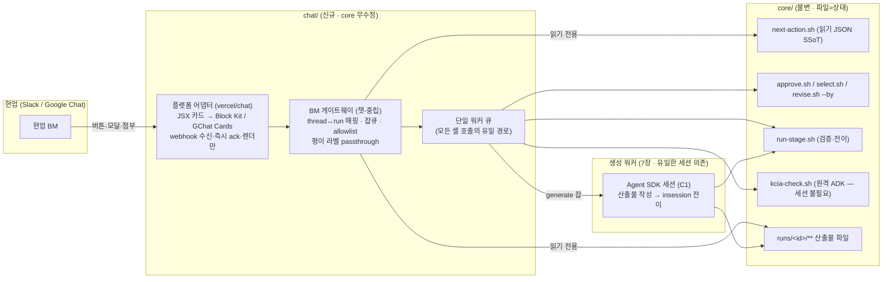

# 챗 레이어 구축 계획 — BM 게이트웨이(B2) + vercel/chat · 1차 브리프 구간

> **지위**: `docs/plans/`(진행 중 계획). **1차(브리프 구간) 구현 완료**(2026-07-12 · `feat/chat-layer-plan` · 13장 진행 로그). 남은 것 = S-1/S-2 스파이크·2차 이후(9장).
> **작성**: 2026-07-11. 근거 = 리서치 3건(Claude Tag 공식 문서 · Slack/Google Chat 플랫폼 검증 · OpenTag/유사 OSS 비교, 전부 2026-07-11 실시)
> + 구 문서 2건(git 이력 복원: `v2-chat-interface-research.md` 2026-06-17 · `slack-poc-plan.md` 2026-06-25, 커밋 `1eb0e47~1`의 `core/docs/_archive/`)
> + 현행 코드 실측(`next-action.sh` · `phase-descriptors.json` · `run-stage.sh` 생성 게이트 · `render.py`).
> **관계**: 규칙 SSoT = [`../../core/AGENTS.md`](../../core/AGENTS.md)(불변). 흐름 정본 = [`../canonical/workflow-ssot.md`](../canonical/workflow-ssot.md).
> 이 계획은 **core 를 한 줄도 수정하지 않는 것**을 1차 전제로 한다(아래 11장).

---

## 0. 한 줄 정의

비개발 현업(마케터)이 **Slack/Google Chat 에서 하네스 내부(파일·셸·JSON)를 전혀 보지 않고**, BM 내용만 —
작업물(문구·구성안·디자인)을 보고 · 여러 안 중 고르고 · 승인/보완을 말하고 — 으로 런을 완주하게 하는
**독립 챗 레이어**를 만든다. 구조 = **B2 2계층**(플랫폼 어댑터 ← BM 게이트웨이 → 하네스 셸 계약),
어댑터 기반 = **vercel/chat (Chat SDK)**, 1차 구현 범위 = **브리프 구간**(new-run → 00-ingest → [00g] → 01-brief).

---

## 1. 잠긴 결정 (2026-07-11 사용자 확정 — 변경 시 재합의)

| # | 결정 | 근거 |
|---|---|---|
| 1 | **레이어 형태 = B2 2계층**: 챗-중립 "BM 게이트웨이" + 플랫폼 어댑터 | 느슨한 결합 요구. 플랫폼 교체·병행(Slack↔Google Chat↔장래 웹)이 어댑터 교체로 끝남. 대화형 확장(9장)도 같은 게이트웨이 재사용 |
| 2 | **어댑터 기반 = vercel/chat** (`npm i chat` + `@chat-adapter/slack` · `@chat-adapter/gchat`, MIT) | Slack+Google Chat 을 **한 코드(JSX 카드)** 로 커버하는 유일한 활성 SDK(2.2k★, 2026-07 릴리스 활발). 카드가 Block Kit/Google Chat Cards 로 각각 렌더됨 |
| 3 | **1차 구현 = 브리프 구간만** (new-run → 인입 → [00g 확정] → 01-brief 승인·심의) | 작게 검증. 다안 select(carousel)는 현행 파이프라인상 02·03·04 에 있으므로 2차(8장 정정 참조) |
| 4 | **하네스와 병렬 개발** — core 무수정, 결합은 기존 공개 계약 4면만(4장) | 다른 세션의 seam 작업(harness-skeleton-and-seams)과 충돌 없음(2장) |
| 5 | **공식 Claude Tag · OpenTag 류 완제품 비채택** | Claude Tag = Anthropic 호스팅 샌드박스+GitHub 전용(로컬 파일·셸 불가, confirmed). CopilotKit/OpenTag = 생후 2주·릴리스 0. OpenClaw = 2026 보안사고 이력·라이선스 불명(규제 도메인 부적합). 설계 참고만: amplifthq/opentag(로컬 CLI 라우팅), acip/slack-claude-agent(선택 카드) |
| 6 | **현업 노출은 BM 내용만** — 내부 용어·경로·JSON 미노출 | AGENTS 9번 절(운영자 규칙) 승계. 라벨은 `operator_labels` 산출물(next-action JSON 의 `phase_label`/`gate_label`/`hint`)을 그대로 사용, 챗 레이어가 자체 번역을 만들지 않는다 |
| 7 | **UI 공통분모 원칙**(2026-07-12 사용자 결정): **Slack·Google Chat 양쪽이 지원하는 상호작용만 쓴다** — 카드·버튼·Select(카드 내)·메시지 게시/수정·스레드 답글·멘션·ephemeral. **모달·슬래시 커맨드·파일 첨부 금지**(GChat 미지원 — vercel/chat platform-adapters 매트릭스 실측) | 자유 입력(제품명·워킹백워드 본문·보완 사유)은 전부 **스레드 답글**로, 확인 절차(RA)는 **2단계 확인 카드**로. GChat 활성화(4차)가 어댑터 등록+인증만으로 끝나게 UX 를 교집합에 고정 |

---

## 2. 병렬 개발 보장 — "하네스 변경과 무관한가?"에 대한 답

**답: 그렇다. 단 두 가지 조건과 한 가지 예외를 지킨다.**

챗 레이어가 하네스에 대해 아는 것은 **이미 존재하는 공개 표면 4면뿐**이고(4장), 전부 읽기 또는 CLI 호출이다.
다른 세션에서 진행 중인 seam 작업(A~F)은 하네스 **내부** 품질 메커니즘이라 이 표면을 바꾸지 않는다
(Seam D 가 run.md/export 표면을 만지지만 next-action JSON 은 additive 원칙).

- **조건 1 — 계약 고정**: 4장의 계약을 이 문서로 동결(additive-only). 챗 레포 쪽에 **계약 픽스처 테스트**를 둔다
  (대표 상태별 `next-action.sh` JSON 스냅샷 → 필드·enum 검증). 하네스 쪽에는 이미 `test-b8`(next-action 회귀 14/14)이
  있어 반대 방향도 지켜진다.
- **조건 2 — 오프라인 stub 로 독립 개발**: `HARNESS_OFFLINE=1` 이면 파이프라인 전체가 **결정적 stub** 으로 완주한다
  (CI 골든과 동일 메커니즘). 챗 레이어의 E2E 개발·테스트는 실엔진·API 키·하네스 브랜치 상태와 무관하게
  로컬에서 전 구간 반복 가능하다. **이게 병렬 개발의 실질 보증이다.**
- **예외(유일한 동기화 지점) — 생성 워커**: 실엔진 생성은 세션 안(insession)만 허용되므로(7장), 생성 자동화(C1)만
  하네스의 생성 규약과 접점이 있다. 이것도 core 수정이 아니라 **스파이크 1건**(7장)이고, 스파이크 결과가 나올 때까지
  어댑터·게이트웨이 개발은 stub 으로 선행한다.

배치: 모노레포 최상위 형제 `chat/` (core·packs 와 나란히). **core 코드 import 0** — 오직
`bash core/scripts/*.sh` spawn + `core/runs/**` 읽기. 독립 `package.json`·독립 테스트·독립 배포 단위.
core CI(run-ci.sh)는 `chat/` 을 모른다(역방향 의존도 0).

---

## 3. 아키텍처

책임 분리(구 v2 문서의 "어댑터 4책임"을 2계층으로 재배분):

| 계층 | 아는 것 | 모르는 것 | 보유 상태 |
|---|---|---|---|
| **플랫폼 어댑터** | vercel/chat 이벤트·JSX 카드·플랫폼별 파일 전달 | 하네스(셸·경로·state) | 없음 |
| **BM 게이트웨이** | 4장의 계약 4면 · thread↔run 매핑 · 잡큐 · allowlist | 챗 플랫폼(Slack/GChat 구분) | thread↔run 매핑 1개(SQLite 또는 JSON) |
| **하네스(core)** | 전부(파일=상태) | 챗의 존재 | state.json + 산출물(불변 원칙) |

불변식 승계(AGENTS 1번 절): **state.json 은 오직 scripts 가 쓴다** — 게이트웨이·어댑터는 셸 호출과 파일 읽기만.
멱등·동시성은 봇이 아니라 **코어가 락 안에서 보장**(구 v2 문서의 TOCTOU 결론 유지 — 봇의 사전 읽기는 UX 힌트 전용).
모든 셸 호출은 웹훅 핸들러가 아니라 **워커 큐 단일 경로**(즉시 ack 후 비동기 — Slack 3초/GChat 30초 한도).

---

## 4. 결합 계약 4면 (동결 — additive-only)

챗 레이어가 하네스에 대해 아는 전부. 여기 없는 것(내부 스크립트·스키마·프롬프트·state 직접 접근)은 금지.

### 4-1. 읽기: `next-action.sh <run_id>` → 한 줄 JSON (버튼·카드의 단일 SSoT)

실측 필드(2026-07-11 · `scripts/next-action.sh`):

| 필드 | 의미 | 챗 UI 사용처 |
|---|---|---|
| `action` | `ingest·generate·review·select·approve·raise-limit·resume-*·done` | 카드 종류 분기(5장 표의 행 선택) |
| `phase`/`phase_label`/`step`/`gate`/`status` | 상태(라벨은 평이어) | 진행 체크리스트·헤더 |
| `stage` | generate 일 때 run-stage 인자 | 생성 잡 파라미터 |
| `needs` | ingest 일 때 `bundle_dir` | 인입 안내 |
| `options[]`/`recommended` | select 다안 키 + 추천 top-1 | 옵션 카드 나열·추천 배지 |
| `revise_available` | [다시 제안]/[직접 입력] 버튼 노출 신호 | select·approve 카드 |
| `ra_ok_required` | 01-brief 기능성 표시 → RA 확인 필요 | 승인 카드에 RA 확인 단계 표시 |
| `gate_type`/`stop_reason` | 게이트 종류·구조화 멈춤 사유 `{code,summary,required_fields}` | 멈춤 안내 카드 |
| `advisory` | 읽기전용 보완 권고 `{must_fill,nice_to_have,completeness}` | "채우면 좋아요" 안내 |
| `iteration`/`max_iterations`/`awaiting` | 반복 상태 | (내부 참고 — 현업 미노출, 라벨만) |
| `cmd`/`gate_label`/`hint`/`files` | 사람용 문구 + **검토 파일 경로 목록** | 문구는 그대로 게시, `files` 로 산출물 첨부 결정 |

### 4-2. 쓰기: 4동작 CLI (전부 기존 — 인자 규약 고정)

| 챗 동작 | 호출 | 비고 |
|---|---|---|
| 새 런 | `new-run.sh <id> "<제품명>" <제품유형> <도메인> [--format ...]` | 도메인·포맷 선언은 사람(모달 입력) — AI 자동분류 없음(AGENTS 8번 절) |
| 인입 | `ingest-bundle.sh` / `run-stage.sh ingest` | 1차 경로는 8장 |
| 생성 | `run-stage.sh <stage> <id>` | **실엔진은 생성 워커 경유만**(7장). 검증·전이는 셸이 수행 |
| 심의 | `kcia-check.sh <id>` | 원격 ADK HTTP — 세션 불필요, 게이트웨이 워커가 직접 호출 |
| 승인 | `approve.sh <id> ["코멘트"] [--ra-ok] --by chat:<플랫폼>:<user>` | 멱등은 코어 락. `--by` 감사 스레딩 기존 지원 |
| 선택 | `select.sh <id> <옵션키> --by chat:...` | 〃 |
| 보완/재제안 | `revise.sh <id> "<사유>" --by chat:...` | 자유 텍스트 = 모달 입력 |
| 한도 상향 | `run-stage.sh raise-limit <id>` | escalated 복구 |

### 4-3. 산출물 파일 (읽기 전용 · `files` 필드가 가리키는 것 + 단계 규약 경로)

| 무엇 | 경로(현행) | 챗 전달 형태 |
|---|---|---|
| 진행 보드 | `runs/<id>/run.md` | 요약 블록(전문은 파일 첨부) |
| 브리프 | `runs/<id>/01-brief/brief.json`(+PR/FAQ md) | 핵심 필드 카드 + md 첨부 |
| 컨셉 다안 | `runs/<id>/02-concept/options/<axis>/{rtb.json,key-message.json}` | 축별 요약 카드 |
| 스토리라인 다안 | `runs/<id>/03-storyboard/outline/options/<key>/` | 안별 요약 카드 + md 첨부 |
| 디자인 다안 | `runs/<id>/04-keyvisual/options/<opt>/index.html` + **`shots/full.png`·섹션 캡처**(`render.py`) | **PNG 업로드**(HTML 은 챗에서 렌더 불가 — 구 PoC 결론 유지) |
| 심의 결과 | `*-verdict.json`(위치는 `phase-descriptors.json`) | verdict 카드(평이어 사유) |

### 4-4. 평이 라벨

`operator_labels` 가 만든 문구가 next-action JSON(`phase_label`·`gate_label`·`hint`·`cmd`)에 이미 실려 온다.
**챗 레이어는 이 문구를 그대로 쓰고 자체 번역 사전을 만들지 않는다**(이원화 금지 — 하네스 쪽
`test-operator-language` 회귀가 원천을 지킨다).

**계약 변경 규칙**: 하네스 쪽에서 필드 추가는 자유(additive). 필드 삭제·의미 변경은 챗 픽스처 갱신과 같은
변경(커밋)에서만. 챗 레이어는 미지 필드를 무시하도록 파싱한다.

---

## 5. 전 기능 → 챗 UI 매핑 (설계 확정 — 전체 파이프라인)

> 구현은 1차=브리프 구간(8장)이지만, **UI 계약은 전 단계를 지금 확정**한다. **UI 공통분모 원칙(1장 결정 7)**:
> 카드 1벌(vercel/chat 함수형)이 Slack Block Kit / Google Chat Cards 로 동일 렌더되는 **교집합 요소만** 쓴다 —
> 모달·슬래시·파일첨부·carousel 없음(vercel/chat 에 Carousel 컴포넌트 자체가 없음 — 실측). 자유 입력=스레드 답글.
> 게이트 실태는 `phase-descriptors.json` 실측 기준.

| 단계 · action | 현업이 보는 것(BM 내용만) | UI(공통분모: 카드·버튼·Select·답글) | 호출(4-2) | 비고 |
|---|---|---|---|---|
| 시작 | "새 작업 시작" | **@멘션** → 설정 카드(규제도메인·포맷 **Select** + [시작]) · **제품명은 답글**로 수집(placeholder 진행 차단) | `new-run.sh` | 진입=멘션(슬래시 아님) · 1 스레드=1 run |
| `ingest` | "자료 본문을 답글로 붙여넣어 주세요" | 안내 카드 + **답글 붙여넣기**(제출별 불변 파일) · [붙여넣기 없이 진행]은 운영자 스테이징(번들+WB) 완비 시만 | 8장 경로 | 파일 첨부 금지(첨부 답글은 통째 거절) · 마크다운 구조 보존(stringifyMarkdown) |
| 00e(조건부) | 참고 문서 반영 제안 요약 | 제안 카드 + [확정]/[보완(사유 답글)] | `approve.sh`/`revise.sh` | — |
| 00g(조건부, **단안**) | "비슷한 제품 참고 메모" 요약 | 메모 카드 + [확정]/[다시 써줘(사유 답글)] | `approve.sh`/`revise.sh` | 구 PoC 의 "3안 carousel" 전제는 **파기됨** — 단안 확정 |
| `generate`/`review`(자동) | "만드는 중…"/"규정 점검 중…" 진행 카드 | 상태 카드(봇이 자동 연쇄 — 브리프 구간까지) | 생성 워커(7장)·`kcia-check.sh` | 실패 시 자동 재시도 없음(사유 게시) |
| 01-brief `approve` | 핵심 정리(누구에게·무엇을·왜) 요약 | 요약 카드 + [승인]/[보완(사유 답글)] · `ra_ok_required` 면 **RA 2단계 확인 카드**([확인 완료 · 승인] 클릭만이 ra_ok) | `approve.sh [--ra-ok]`/`revise.sh` | RA 게이트 보존(버튼 value 에 ra_ok 비탑재) |
| 02-concept `select` (**다안**) | 메시지 후보 N안(축별 RTB·키메시지 요약) | 옵션별 카드 나열+추천 배지 + [이걸로] 버튼(또는 Select) + [다시 제안]/[직접 입력=답글] | `select.sh`/`revise.sh` | 양 플랫폼 카드 나열(캐러셀 없음) |
| 03-storyboard outline `select` (**다안**) | 페이지 구성안 여러 개(안별 요약) | 〃 (전문은 카드 본문 요약 — 파일 첨부 아님) | 〃 | 〃 |
| 03-storyboard plan (단안) | 확정 구성안 상세 | 요약 카드 + [승인]/[보완(사유 답글)] | `approve.sh`/`revise.sh` | — |
| 04-keyvisual `select`+**선택 후 승인** | 디자인 시안 A/B/C — `shots/full.png` + 섹션 캡처 | **카드 내 이미지**(양 플랫폼 ✅ — 게이트웨이가 이미지 HTTPS 서빙) 나열 → 선택 → **확정 승인 카드 1번 더**(비가역 2중확인) | `select.sh` → `approve.sh` | 파일 업로드 대신 카드-이미지 URL(공통분모) — 호스팅은 게이트웨이 몫(3차 설계) |
| `review`(01~04 뒤 자동) | 규정 점검 결과: 통과🟢 / 보완 필요🟠+사유 / 사람 확인 필요🔴 | verdict 카드(사유는 평이어) + 🟠[보완 반영 재생성] | `kcia-check.sh` → 재생성/에스컬레이션 | 생성≠심의 별도 카드 · 에스컬레이션은 [한 번 더 시도] 복구 카드 |
| `raise-limit` | "여러 번 보완해도 안 풀렸어요 — 한 번 더 시도할까요?" | [한 번 더] 버튼 | `run-stage.sh raise-limit` | — |
| `stop_reason`/`advisory` | 멈춘 이유·채우면 좋은 것(평이어) | 안내 카드 | (읽기 전용) | — |
| `done` | 완료 요약 + 최종 산출물 | 완료 카드 + 파일 첨부 | — | — |

공통 규칙: **스레드 = run 1:1**(감사추적) · 모든 버튼 `action_id`류 페이로드에 `{run_id, action, 대상}` ·
진행표시 3계층(체크리스트/현재 한 줄/상세 파일) · 버튼 클릭자 → `--by chat:<플랫폼>:<user>` 로 코어 감사 기록.

---

## 6. BM 게이트웨이 상세

- **책임**: ① next-action JSON → 챗-중립 ViewModel 변환(라벨 passthrough) ② thread↔run 매핑(유일한 자체 상태)
  ③ 모든 쓰기 동작의 **잡큐 직렬화**(run 별 FIFO — 코어 락과 이중 안전) ④ 산출물 파일 → 전달물(요약/첨부/이미지) 조립
  ⑤ 권한(승인자 allowlist)·감사(`--by`)·플랫폼 파일 수신 저장.
- **멱등·동시성**: 봇은 판정하지 않는다 — `approve.sh` 등이 락 안에서 status 검사(기존). 게이트웨이는 종료코드/출력으로
  "이미 처리됨"을 사용자에게 평이하게 회신.
- **비동기**: 웹훅 핸들러는 즉시 ack + "처리 중…" 게시 → 워커가 셸 실행 → 완료 시 메시지 갱신. 생성처럼 긴 작업은
  하트비트(체크리스트 카드 갱신).
- **보안**: 사내 워크스페이스 전용 앱 · 승인자 allowlist(게이트 동작) · 웹훅 서명 검증(vercel/chat 내장 여부 스파이크 S-2) ·
  미공개 BM 자료가 챗 플랫폼(외부 SaaS)에 게시되는 범위는 **회사 협업툴 보안 기준으로 사전 확인**(구 v2 문서 리스크 유지) ·
  시크릿은 env(리포 밖).
- **호스팅(1차)**: 로컬/사내 VM 단일 프로세스. vercel/chat 은 **webhook(HTTP) 모델**이므로 PoC 는 터널(cloudflared 등)
  또는 사내 리버스프록시로 공개 엔드포인트 확보(구 문서의 "Socket Mode = 공개 URL 0" 이점은 vercel/chat 채택으로 포기 —
  트레이드오프 수용, 리스크 R-1). 운영 확장 시 Cloud Run(+`runs/` 는 GCS FUSE) — 구 v2 문서 7.5 절 결론 그대로 유효.

---

## 7. 생성 백엔드 — 유일한 세션 의존점

전제(현행 코드 실측): `run-stage.sh` 는 **세션 밖 실엔진 헤드리스 생성을 fail-closed** 로 막는다
(도달 가능 = insession[실엔진] 또는 subprocess+stub[CI]). 구 v2 문서·구 PoC 의 "봇이 `claude -p` 를 spawn" 전제는
**무효** — 이 계획은 그 대체 경로를 확정한다.

- **C1 (목표) — Agent SDK 생성 워커**: 하네스와 같은 머신에서 Claude Agent SDK 세션이 ① 산출물 파일 작성 →
  ② `HARNESS_CLI=claude HARNESS_GEN_MODE=insession bash scripts/run-stage.sh <stage> <id>` 실행(검증·전이는 셸).
  현행 insession 1급 경로와 등가 — core 무수정.
  - **스파이크 S-1(차단 게이트, 반나절)**: SDK 세션의 Bash 서브프로세스에 신뢰 마커(`CLAUDECODE`/`CLAUDE_CODE_ENTRYPOINT`)가
    주입되는지 실측(같은 Claude Code 런타임이라 가능성 높음 — 미주입이면 `detect_insession_engine` 이 fail-closed).
    통과 기준 = 사람 개입 0으로 1개 스테이지 생성+검증+전이 완주. 인증 = `ANTHROPIC_API_KEY`(과금: 2026-06-15 별도
    크레딧 풀 변경은 **취소 확정** — 재확인 완료 2026-07-11).
  - 생성≠심의 불변: 워커는 생성만. 심의는 기존 원격 ADK(`kcia-check.sh`) — 게이트웨이가 직접 호출(세션 불필요).
- **C2 (폴백/브리지) — 운영자 세션 브리지**: 게이트웨이가 생성 잡을 파일 큐(`chat/jobs/`)에 적고, 운영자의
  Claude Code 세션(/loop 또는 수동)이 소비해 기존 `/brief` 류 스킬로 생성. 현업 챗 UX 는 동일(카드가 "만드는 중…"),
  자동화만 반수동. **S-1 실패 시 1차는 C2 로 출하 가능** — 어댑터·게이트웨이 개발이 S-1 에 막히지 않는 이유.
- **C3 (비채택) — 헤드리스 subprocess 부활**: 폐기 결정(600초 행·0바이트·자가심의 가드) 재협상이라 하지 않는다.

---

## 8. 1차 범위 — 브리프 구간 (구 PoC 계획의 정정 계승)

**구 slack-poc-plan(2026-06-25) 대비 정정 2건**: ① "00g 3안 carousel" 전제 파기 — 현행 00g 는 **단안 approve·심의 면제**
(carousel 검증은 02-concept 로 이동, 2차) ② "실 `claude -p`" 전제 무효 — 생성은 7장(C1/C2).
계승: 스레드=run · 버튼 SSoT=next-action · 멱등=코어 락 · `--by` 감사 · 로컬 우선.

**1차 사용자 흐름**(UI 공통분모 — 1장 결정 7 · 연결은 Slack Socket Mode, DM 은 범위 밖=채널 스레드만):

1. 현업: 채널에서 **@봇 멘션** → 설정 카드(규제도메인·포맷 **Select** + [시작]) 게시 · **제품명은 답글**로
   알려줌(카드에 수집 상태 반영 재게시). 셋 다 있어야 [시작] — 제품명 placeholder("제품") 진행은 다제품 추출 키
   (`state.product.name`) 오염이라 차단. [시작] → `new-run.sh --name` → 스레드↔run 바인딩(1 스레드=1 run · 재멘션/재시작은 안내만).
2. 인입: 크롤 번들은 **운영자 사전 스테이징**(`CHAT_BUNDLE_DIR`) · 워킹백워드는 **본문을 스레드 답글로 붙여넣기**
   (제출별 불변 파일 저장 → `HARNESS_WB` 로 인입, 마크다운 구조 보존[stringifyMarkdown]) → ingest 잡.
   파일 첨부는 코멘트가 딸려도 통째 거절(공통분모 — GChat 미지원) · [붙여넣기 없이 진행]은 번들+WB(`CHAT_STAGED_WB`)
   둘 다 스테이징됐을 때만(아니면 레포 샘플 WB 폴백 오인입이라 fail-closed). 인입 '성공' 시에만 붙여넣기 대기 해제(실패=재붙여넣기 복구).
3. (사례 있으면) 00g: 참고 메모 카드 → [확정] / [다시 써줘] → **사유를 답글로**(승인자 답글만 수용) — 승인 즉시 자동 통과(심의 면제).
4. 01-brief: 생성·심의는 봇이 자동 연쇄(브리프 구간까지 · 실패 시 자동 재시도 없이 사유 게시) → 완료 카드(핵심 정리 요약)
   → [승인]/[보완(사유 답글)] — `ra_ok_required` 면 **RA 2단계 확인 카드**([확인 완료 · 승인] 클릭만 ra_ok, 승인자 한정)
   → 승인 후 **심의 verdict 카드 자동 게시**(🟢/🟠/🔴) → 🟠이면 [보완 반영 재생성] 루프 · 에스컬레이션은 [한 번 더 시도]
   → 통과 시 "다음 단계(메시지 정하기)는 담당자와 진행" 안내로 1차 종료.

**완료 기준(DoD)** — 상태(2026-07-12):
- ✅ 게이트웨이가 브리프 구간을 **stub 으로 완주**(E2E `brief-flow.e2e.test.ts`: 인입→가이드라인→01-brief→브리프→02-concept). 실 Slack 1건은 **S-2(수동) 대기**.
- ✅ 중복 승인 멱등(코어 락) — E2E 가 "지난 차례" 거부 확인.
- ✅ `history.actor=chat:slack:U-e2e` 감사 기록 확인(E2E).
- ✅ 계약 픽스처 테스트(브리프 구간 상태 6종) green.
- ✅ core diff = 0 (`verify.sh` 가 `git status --porcelain -- core/` 로 증명).

**작업 분해**(순서 = 의존, W1~W3 는 stub 만으로 진행 가능 · S-1 은 W1 과 동시 착수):
- W1 `chat/` 스캐폴드: 게이트웨이(계약 클라이언트 + thread↔run 매핑 + 잡큐) + 계약 픽스처 테스트.
- W2 vercel/chat 어댑터: 5장 표의 브리프 구간 카드 4종(시작 모달·인입·approve·verdict) + Slack 파일 업로드.
- W3 인입 경로: 첨부 수신 → 저장 → ingest 트리거.
- W4 생성 연결: S-1 통과 시 C1 워커, 실패 시 C2 브리지.
- W5 E2E: stub 완주 → 실엔진 1건 → DoD 체크.

---

## 9. 2차 이후 로드맵

| 차수 | 범위 | 비고 |
|---|---|---|
| 2차 | 02-concept·03-outline **다안 select**(옵션 카드·추천 배지·[다시 제안]/[직접 입력]) — carousel 검증의 본진 | 5장 UI 계약 그대로 구현만 |
| 3차 | 04-keyvisual: PNG 시안 카드 + 선택 후 **확정 승인 2중** + 최종 패키지 전달 | Slack files_upload_v2 |
| 4차 | Google Chat 어댑터 활성화(`@chat-adapter/gchat`) | 이미지 = 게이트웨이 호스팅 URL 1단계 추가 · 첨부 수신 user-auth 제약 검증 |
| 5차 | 대화형 Q&A(A2): 같은 게이트웨이를 도구(MCP/함수)로 노출한 에이전트가 "이 시안 근거가 뭐야?" 류 읽기 질의 응답 — **게이트(승인·선택)는 계속 버튼만**(감사·결정성) | Slack `agent_view`(2026-06-30, 유료 플랜) 검토 |
| 차후 | **인박스 폴더 인입**(2026-07-12 사용자 확정 — 차후): 봇 머신의 약속 폴더(예: 구글 드라이브 동기화 폴더)=`CHAT_INBOX_DIR/<run>` 에 현업이 파일을 밀어넣고 챗에서 [자료 다 넣었어요] → 1단계 결정적 규약 식별(번들 구조·*.md) → 2단계 core `00a-intake` 분류 제안+챗 승인 | 플랫폼 무관(파일시스템) — 파일첨부 공백 해소. 드라이브 '링크 공유' 방식은 비권장(인증·유출) |
| 운영화 | Cloud Run(+GCS FUSE)·Events HTTP·`deadline`+`sweep-stale`(무응답 에스컬레이션, 구 v2 문서 7.7) | 구 v2 결론 유효 — 단 sweep-stale 은 core 추가라 별도 승인 |

---

## 10. 리스크 · 스파이크

| # | 리스크 | 완화 |
|---|---|---|
| R-1 | ~~vercel/chat = webhook 모델 → 공개 엔드포인트 필요~~ | **✅ 해소**: vercel/chat 이 Slack **Socket Mode**(`mode:"socket"`+appToken) 지원 확인 → 인바운드 오픈 없이 상주 Node 자체호스팅(공개 URL 불요). 구현도 Socket Mode 로 배선(`bot.ts createBot`) |
| R-2 | vercel/chat 세부 API 미확정(모달·파일 수신·서명검증·GChat 카드 제약) | **스파이크 S-2(1일)**: 브리프 구간 카드 4종을 실 Slack 워크스페이스에 렌더해 확정. 릴리스가 활발(=API 변동)하므로 버전 고정 |
| R-3 | S-1(Agent SDK insession 마커) 실패 | C2 브리지로 1차 출하, C1 은 후속(7장) |
| R-4 | Google Chat 파일 입출력 제약(user-auth·공개 URL) | 4차로 격리. 게이트웨이 이미지 호스팅 설계는 5장에 선반영 |
| R-5 | 미공개 BM 자료의 챗 게시 범위 | 사내 협업툴 보안 기준 사전 확인(현업 채널 비공개·보존 정책) |
| R-6 | 계약 드리프트(하네스 seam 작업과 경합) | 2장 계약 픽스처 + additive-only 규칙. 위반은 픽스처가 즉시 검출 |

---

## 11. 하네스(core)에 요구하는 변경

**1차 = 0건.** 계약 4면이 전부 기존 표면이다.

장래 additive 후보(전부 별도 승인 · 챗 레이어가 없어도 무해한 것만): ① next-action JSON 에 `artifacts[]`
(단계별 전달물 매니페스트 — 지금은 `files`+규약 경로로 충분) ② `deadline`+`sweep-stale.sh`(무응답 에스컬레이션)
③ 02-concept 옵션 요약 필드 정규화. — 필요가 실측되기 전에는 만들지 않는다.

## 12. 고지

본 챗 레이어·산출물은 **법적 통과 보증이 아니며 자율·비법적 사전 점검**이다. 최종 책임은 사람(현업/RA)에게 있다
(AGENTS 7번 절). 챗 UI 의 승인·선택 버튼은 그 사람 판단의 기록 수단이지 판단의 대체가 아니다.

---

## 13. 1차 구현 진행 로그 (2026-07-12 · `feat/chat-layer-plan`)

**위치**: `chat/`(core 형제, core 무수정). 29개 TS 파일 · **157 테스트** · verify.sh(build·test·core diff=0·픽스처 멱등) green.
dev-loop(4 wave, wave당 Codex 리뷰 critical/high 0까지 반복)로 구현. 계획 대비 확정·정정 사항은 아래.

| Wave | Stage(커밋) | 산출 | 리뷰 수렴 요지 |
|---|---|---|---|
| W1 | A (`fec6136`) | ESM 스캐폴드 · 계약 타입(next-action 24필드) · config | 하드코딩 경로→체크아웃 유도 |
| W2 | B·C·G (`9b98e8a`) | 계약 클라이언트+ViewModel+셸래퍼 · 파일 StateAdapter+thread↔run · 인입 | 플래그 주입(RA 우회) 차단 · 비밀 스크럽(.env 재유입) · 락 write-tmp+link 원자성 · rid 경로안전(읽기·쓰기) |
| W3 | D·E·F1·H (`da3b1a5`) | 잡큐+워커 · 픽스처6+계약테스트 · Slack 카드4종 · 생성실행기 | **spawnSync→비동기 spawn**(이벤트루프 블로킹) · RA 엄격 boolean · generate stage allowlist(제어verb 스머글링) · stale ingest 가드 |
| W4 | F2·I (`bfd1185`) | Slack 봇 배선(Socket Mode)+기동 · stub E2E · verify.sh | 채널→답글스레드 id 구성 · 스레드 구독 · deriveVerdict(status 기준) · 실패 잡 재큐 중단 · **브리프 경계서 자동생성 정지(1차 범위)** · 에스컬레이션 복구 카드 |

**계획 대비 확정/정정**:
- **R-1 해소**: vercel/chat Slack **Socket Mode** 지원 → 공개 URL 불요(10장 갱신).
- **생성 백엔드(7장)**: S-1 미검증 → **1차 기본 = C2 브리지**(운영자 세션 소비). 오프라인/CI 는 `StubDirectGenExecutor` 직접. 온라인 실엔진 헤드리스는 core fail-closed 라 금지 유지.
- **인입(8장)**: 워킹백워드 = 챗 업로드(`.md`, pandoc 로 `.docx`) · 크롤 번들 = 운영자 사전준비 `CHAT_BUNDLE_DIR`. 워커가 둘을 함께 ingest-bundle 로.
- **자동/사람 게이트**: 생성·심의는 봇이 자동 진행(브리프 구간까지), **사람은 승인/보완만**(버튼). 보완=사유 모달, RA 필수 승인=담당자 확인 모달(ra_ok 우회 방지).

**남은 것(별도 진행)**:
- **S-2(실 Slack 수동 검증)**: 실 토큰(`SLACK_BOT_TOKEN`·`SLACK_APP_TOKEN`) 연결 후 카드 4종·모달 렌더 확인. 특히 `bot.ts replyThreadId`의 Slack thread-id 형식(코드 `⚠ S-2` 주석)·모달 3초 ack 실측.
- **S-1(Agent SDK insession 마커)**: 통과 시 온라인 생성을 브리지→직접 세션으로 승격.
- **2차 이후(9장)**: 다안 select(carousel)·키비주얼 PNG·Google Chat·대화형.
- **신규 env**(config-reference 편입 후보 — chat 레이어 전용이라 core SSoT 아님): `CHAT_APPROVERS`·`CHAT_BUNDLE_DIR`·`CHAT_STATE_DIR`·`CHAT_DATA_DIR`·`CHAT_JOBS_DIR`·`CHAT_NEW_RUN_COMMAND`·`SLACK_BOT_TOKEN`·`SLACK_APP_TOKEN`·`SLACK_SIGNING_SECRET`.

**커밋**: 이 브랜치(`feat/chat-layer-plan`)에 계획(`e77b48f`)+W1~W4 4커밋. **미푸시**(사람 검토·PR 대기).

---

### 13-1. v2 — UI 공통분모 재설계 (2026-07-12 사용자 결정 · 같은 브랜치)

**결정**: Slack·Google Chat **양쪽 지원 기능만** 사용(1장 결정 7). 근거 = vercel/chat `platform-adapters.mdx`
실측 매트릭스(모달·슬래시 커맨드·파일 업로드 = GChat ❌ / 카드·버튼·Select·ephemeral·edit = 양쪽 ✅ ·
Carousel 컴포넌트는 SDK 에 없음). Slack 전용 3요소 위에 있던 1차 앞단을 전면 대체:

| Slack 전용(제거) | 공통분모 대체(구현) |
|---|---|
| `/new-run` 슬래시 | **@멘션** 진입(`onNewMention` · 구독 스레드 재멘션은 pending 없을 때만 setup) |
| 시작 모달(제품명·도메인·포맷) | **설정 카드**(Select 2 + [시작]) + **제품명 답글** 수집(placeholder 진행 차단 — 다제품 추출 키 보호) |
| RA 확인 모달 | **RA 2단계 확인 카드**([확인 완료 · 승인] 클릭만 ra_ok · 승인자 한정) |
| 보완 사유 모달 | **사유 답글** 캡처(승인자 클릭·승인자 답글만 · 대기 선점 차단) |
| 워킹백워드 파일 첨부(+pandoc) | **본문 답글 붙여넣기** — 제출별 불변 파일(`working-backwards-<uuid>.md`) · 마크다운 보존(`stringifyMarkdown`) · 첨부 답글은 통째 거절 |

**신규 부품**: `PendingInputStore`(스레드별 대기 입력 — setup/wb/feedback · 락 직렬화 merge+락 안 재검증) ·
`setupCard`/`raConfirmCard`/`escalationCard` · `saveWorkingBackwardsText` · env **`CHAT_STAGED_WB`**(스테이징 WB —
[붙여넣기 없이 진행]은 번들+WB 완비 시만, 아니면 레포 샘플 WB 오인입이라 fail-closed).

**Codex 리뷰 다사이클 수렴(critical/high 0)** — 주요 해소: 설정 Select placeholder(P1 — Slack Actions 블록 카드 거부) ·
제품명 상실(P1 — placeholder "제품" 고정) · 스테이징 WB 없는 skip 진행(P1 — 샘플 오인입) · stale 카드/Select/재멘션의
대기 리셋·선점 계열(TOCTOU 락 재검증 포함) · wb 대기 수명(인입 성공 시 해제 — 실패 복구 보존) · run 전진 시 stale
feedback 무효화 · DM 범위 밖 선언(threadId 규약 미실측 표면 제거). 테스트 177(+E2E 1) · core diff=0 · 픽스처 멱등.

**S-2(실 Slack 수동 검증) 스코프 갱신**: 모달·3초 ack 항목 소멸(모달 없음) → 남은 실측 = 멘션 threadId·카드 Select
액션 페이로드(양 플랫폼)·Socket Mode 연결. GChat 활성화(4차) = 어댑터 등록+인증(webhook/JWT)+이미지 URL 서빙(3차)만.

---

## 14. 저장소 분리 — 검토·준비했으나 보류(모노레포 병합 선택)

챗 게이트웨이의 저장소 분리(헥사고날 어댑터 정렬 · 접점 실측 · 단계 S1~S8 · DoD)는
**[`chat-gateway-split-plan.md`](../_archive/chat-gateway-split-plan.md)** 에 준비·검증(dev-loop)까지 마쳤으나 **실행하지 않았다** —
2026-07-13 사용자가 분리 대신 **모노레포 병합**을 택해 `chat/` 는 `main` 에 병합됐다(merge commit `2dd84cb`).
그 계획 문서는 `_archive/` 로 옮겼다(분리를 되살릴 경우 S1~S8·DoD 그대로 유효). 현행 `chat/` 는 이미 분리-READY
(HARNESS_ROOT 주입·`../core` 기본값 제거·테스트/verify 2계층).
요지: core 하네스=애플리케이션 코어, 포트=계약 4면(4장), 챗=driving adapter.

**갱신(2026-07-13)**: 분리-READY 잔재였던 `HARNESS_REF`(커밋 핀) 폐기 — 모노레포 병합으로 chat·core 가
같은 커밋으로 공진화하니 커밋 핀은 잉여다(읽는 코드 0 확인 후 삭제, 부활 시 커밋-핀 설계는 위 아카이브
분리계획 참조). 드리프트 감지는 verify.sh 통합 검증의 형제 core 픽스처 재캡처 멱등이 계속 맡는다.
