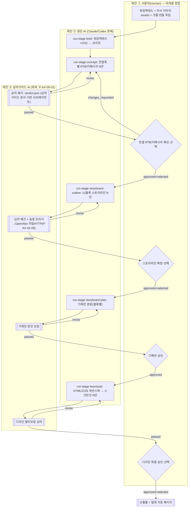
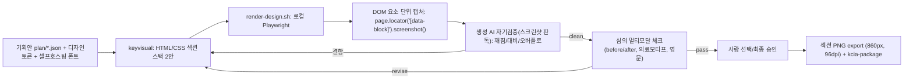

# P-AX-05 상세페이지 생성 자동화 하네스 — 설계 문서 (v1.1)

> 독자: PM(차병환) · AX 개발팀 · 운영 현업(비개발 마케팅 담당자). PoC 운영 조직: 대웅 CH본부 BM2팀.
> 버전: v1.1 (개정·확정안) · 작성일: 2026-06-17
> v1.1: 입력 모델을 워킹백워드 자동추출(claim-basis)+자사 이미지로 정정, 심의 게이트를 심의가이드 문서 기반 서브에이전트로 재정의(§16).
> **범용 범위**: 본 하네스는 규제 대상 제품(**화장품·의약외품·건기식·의약품**)의 홍보/상세 자료를 생성하는 다중도메인 도구다(AGENTS.md §0·§8). 본 문서의 예시·실측은 **PoC 샘플 1례**(이지듀 멜라 비 토닝 앰플 쿠션 — 화장품, 제품명 표기 SPF 50+/PA+++)이며, 교체 가능한 예시일 뿐이다.
> 테스트 기본 번들: `tests/fixtures/bundle-cosmetic`(커밋 가능한 합성 번들 — 실제 크롤 `naver_*/` 심링크는 2026-07-06 decouple). 운영 입력은 현업이 넘긴 크롤 번들 폴더.
> 환경 실측: Codex 0.140.0 · Claude Code 2.1.179 · Playwright 1.61.0 · Node 22 · Python 3.14 (본 문서 §3.3·부록 A에 실측 근거)
>
> ⚠️ **작성 시점 스냅샷 — 일부 초과됨(2026-07-25).** 본 문서가 전제한 **두 CLI(Claude Code·Codex) 공통 substrate 는 폐기**됐다. 생성 엔진은 **Claude 단일**(`HARNESS_CLI=claude|stub`)이고, 세션 밖 헤드리스 실엔진 생성(`claude -p`/`codex exec`)도 폐기됐다(세션 내 생성만). Codex 관련 실측·비교표(§3.3·부록 A·§16의 `codex exec` 심의 서술)는 **당시 조사 기록으로만** 읽는다. 현재 진실은 `core/AGENTS.md`(SSoT)와 `docs/canonical/` 정본이며, 어긋나면 **코드가 우선**이다.

---

## 0. 이 문서를 읽는 법 (v1.1 핵심 변경 한눈에)

이 설계는 "AI가 단계별 산출물을 만들고 → 외부 심의 AI가 화장품 광고 표현을 체크하고 → 사람이 승인" 하는 3주체 게이트 루프를, **Claude Code와 Codex CLI 양쪽에서 동일하게** 굴리는 단일 하네스다. v0.1 초안 대비 다음을 바로잡았다(상세는 §15 개정 요약, v1.1 정정은 §16).

1. **이식성의 1급 경로를 슬래시 커맨드가 아니라 `scripts/run-stage.sh`(비대화 셸 호출)로 바꿨다.** 실측 결과 Codex 0.140은 레포의 `.agents/skills/`를 자동 발견하지 않고 스킬을 `~/.codex/skills/` 전역에 둔다. 슬래시/스킬은 "편의 래퍼"로 강등하고, 결정적 셸 진입점을 표준으로 삼는다.
2. **기능성·실증·성분은 워킹백워드에 근거가 없으면 "주장 불가(unknown/빈 배열)"가 기본값이다.** 실측 `product.json`엔 기능성 승인 여부·고시성분·실증자료가 전혀 없다. 단, 이 정보는 이미 워킹백워드 문서에 들어 있으므로 사람이 별도 입력을 다시 만들 필요가 없다. 입력은 ① `inputs/working-backwards.md`(제품 근거 원천) ② `inputs/assets/`(자사 홍보/BM 이미지 — 디자인 단계 실제 소재) ③ 크롤 번들 폴더(구조·VOC 참고용)의 3가지로 통일한다. 환각을 구조적으로 차단하기 위해, ingest가 워킹백워드에서 기능성 표시·고시성분·인증·제품유형·보유 실증을 **자동 추출**해 `00-ingest/claim-basis.json`(주장 가능 근거표)을 만든다. 근거 없는 효능은 자동으로 `unknown`/빈 배열(=주장 불가)이며, 법적으로 민감한 표시(기능성 표시 등)만 브리프 단계에서 사람이 한 번 확인하는 게이트(approve/revise)로 처리한다(hard-fail 제거, fail-closed 유지). EGF·기미면적 수치·"단 1주만에 주름개선" 같은 초안의 예시는 모두 제거했다.
3. **현 시점 심의 게이트의 1차 방어선은 심의가이드 문서 기반 서브에이전트다.** 협회 검사 에이전트(P-AX-05-01)는 아직 구현 전이므로, `docs/regulation/`의 심의가이드 문서(협회 광고자문 해설서 2025·식약처 표시광고 지침)를 컨텍스트로 받은 **별도 서브에이전트**(생성과 다른 세션/모델 — self-grading 금지)가 산출물을 검사해 `verdict.json`을 남긴다. Claude Code에서는 별도 서브에이전트, Codex에서는 별도 `codex exec` 세션으로 이식한다. 결정적 룰엔진(금지어 매칭)은 **선택적 권장 1차 프리필터(하드닝)**로 위상을 낮춰, 있으면 고위험 금지어를 빠르게 무조건 `revise` 하는 보조 수단으로 남긴다.
4. **상태 쓰기 주체를 `scripts/*.sh`로 단일화**하고, lockfile·원자적 write·idempotent 재개를 명문화했다. 비개발 현업은 JSON을 손으로 고치지 않고 `approve.sh`/`revise.sh`(또는 `/approve`·`/revise`) 한 줄로 승인/보완한다.
5. **VOC·블록 수치는 문서에 하드코딩하지 않고 `voc.json`을 단일 출처로 삼는다.** 본문의 모든 정량 표현은 ingest 산출물 참조다. "11블록"은 12블록으로 통일했다.

---

## 1. 한 장 요약

**무엇을** — 규제 대상 제품(**화장품·의약외품·건기식·의약품**)의 홍보/상세페이지를, "워킹백워드 학습 문서 + 자사 홍보/BM 이미지(`inputs/assets/`) + 수동 크롤 번들(`product.json`·`reviews.csv`·상세 이미지)"을 입력으로 받아(제품 근거표 `claim-basis.json`은 ingest가 워킹백워드에서 자동 추출), AI가 **브리프 → 컨셉 → 콘티/스토리보드 → 키비주얼**의 4페이즈를 단계별 실제 파일 산출물로 생성하고, 매 단계마다 **도메인별 외부 심의가이드 AI**(화장품 예시: 대한화장품협회 광고자문 검사, 하위과제 P-AX-05-01)가 광고 표현을 체크하고, **사람이 승인**해야 다음으로 넘어가며, 마지막엔 실제 **HTML/CSS 상세페이지 + 섹션별 PNG + 심의 자문 신청 패키지**까지 산출하는 단일 하네스다. (아래 상세·실측은 화장품 PoC 예시 기준.)

**왜** — 화장품 상세페이지는 (1) 카피가 화장품법 제13조(부당광고 금지)·제14조(표시·광고 실증제)에 직접 걸리고, (2) 한국형 세로 섹션 스택(12블록 캐논) 구조가 정형화돼 있으며, (3) 소비자 언어(VOC)·실증 근거를 카피에 정확히 묶어야 한다. 이 세 가지는 "AI 단독 생성"으로는 위법·환각 위험이 크고, "전부 수작업"으로는 느리다. 사람·생성 AI·심의 AI의 **3주체 게이트 루프**가 정답이다.

**어떻게** — Claude Code와 Codex CLI **양쪽에서 동일하게 구동**되도록, 두 도구의 *검증된 교집합*으로 짓는다: 루트 마크다운 지침(`AGENTS.md` SSoT + `CLAUDE.md` 얇은 어댑터), **비대화 셸 진입점(`run-stage.sh` → `claude -p` / `codex exec`)을 1급 경로로**, MCP 외부 에이전트, 셸 스크립트 게이트, 그리고 **모든 상태·산출물을 디스크 파일에 두는 파일-as-state 패턴**. 프레임워크(LangGraph/Temporal)를 쓰지 않고 그 *개념*(interrupt/resume, 명시적 enum 게이트, 피드백 주입 재생성, Loop Guard)을 파일+셸로 근사한다.

**기대효과**
- 상세페이지 1건 초안~심의 셀프체크까지 리드타임 단축, 재개 가능해 비동기 검토에 강함.
- 심의 리스크를 *생성 시점*에 차단(주장-각주 페어링, 기능성 표시 조건부 검증, 실증 트리거)하여 식약처 감시·반려·재작업 리스크 감소.
- 산출물이 전부 파일이라 감사 추적(심의 근거·승인 이력)이 자동으로 남음 — 화장품 광고자문 신청 패키지로 바로 제출 가능.
- 동일 하네스가 두 CLI에서 돌아 도구 종속성 제거(조직 도구 정책 변화에 강함).

---

## 2. 문제와 목표

### 2.1 As-Is
- 현업 마케터가 워킹백워드(.docx 제품 학습 문서)와 경쟁/자사 크롤 번들을 손으로 모은다.
- 카피·스토리·디자인을 외주/수작업으로 만들고, 화장품 광고 표현 적법성은 담당자 경험에 의존하거나 협회 자문 단계에서야 발견 → 재작업.
- 산출물·검토 이력이 메신저/메일/PPT에 흩어져 감사 추적·재개가 어렵다.

### 2.2 To-Be
- 임의의 크롤 번들 폴더(`naver_<id>_<ts>`)를 `run-stage.sh ingest`로 정규화 투입하면, ingest가 워킹백워드에서 기능성/실증/성분 근거를 자동 추출해 `claim-basis.json`(주장 가능 근거표)을 생성한다. 사람은 자사 이미지(`inputs/assets/`)만 넣고, 민감 표시는 브리프 단계에서 한 번 확인한다.
- 각 단계가 **실제 파일 산출물(JSON 구조화 + 사람이 읽는 MD)** 을 남기고, 심의 AI가 `verdict.json`을 쓰고, 사람은 `approve.sh`/`revise.sh` 한 줄로 승인/보완한다.
- 4페이즈를 지나면 `runs/<id>/04-keyvisual/design/`에 HTML/CSS 상세페이지 + 섹션별 PNG + 협회 자문 제출 패키지가 생성된다.
- 중단 후 며칠 뒤 어느 CLI로 열어도 `state.json`만 읽어 정확히 재개된다(idempotent).

### 2.3 범위 (In Scope)
- 화장품/뷰티 카테고리(쿠션·패치 등), 한국 이커머스(네이버 우선) 상세페이지.
- 4페이즈 생성 + 심의 셀프체크 게이트 + 사람 승인 게이트 + 보완 루프 + multi-option.
- HTML/CSS → Playwright(로컬 CLI) 렌더 → DOM 요소 단위 섹션 PNG 분할(네이버 860px 규격) 출력.
- 심의가이드 AI(P-AX-05-01)·논문검색(P-AX-02-05 OpenAlex) 연동. **논문검색은 OpenAlex 직접 HTTP 실연동으로 완료**(옛 MCP 노선 폐기 — 온라인=실검색·오프라인=stub, 8.4). 심의는 P-AX-05-01 미완성인 현 시점 심의가이드 문서 기반 서브에이전트(별 세션)로 대체, 선택적으로 룰엔진 프리필터 병용.

### 2.4 비범위 (Out of Scope)
- **의약품** 광고 심의(약사법 영역). 본 하네스는 **화장품법** 광고자문 기준 전용.
- 협회 자문의 **법적 통과 보증**(자문은 자율·비법적. 하네스는 "셀프체크 + 자문 신청 패키지 준비"만 담당. 식약처 사후 감시는 별개).
- 크롤링 자체의 자동화(번들은 *수동 수집* 전제. 하네스는 정규화 ingest만).
- 실제 상품 등록/업로드 API, 결제, 재고.
- 동영상/모션 제작(번들의 `*.gif`는 분석 입력으로만, 산출은 정적 이미지 스택 우선. `motionDemo` 블록은 스키마 확장 여지로만 둠).

---

## 3. 하네스 개념 — "프레임워크"가 아니라 "파일 기반 단계 게이트 하네스"

### 3.1 프레임워크를 쓰지 않는 이유
LangGraph(`interrupt()`+checkpointer)나 Temporal(Signal/Query+durable execution)은 "상태를 영속화하고 사람을 무기한 기다렸다 정확히 재개"하는 이 워크플로의 본질을 잘 구현한다. 하지만 **필수 제약: 단일 하네스가 Claude Code와 Codex 양쪽에서 구동**되어야 한다. 특정 런타임에 워크플로 로직을 박으면 한쪽에서 못 돈다. 그래서 프레임워크의 *개념만 차용*하고 구현은 두 CLI의 교집합으로 한다.

| 프레임워크 개념 | 본 하네스의 파일 기반 근사 |
|---|---|
| `interrupt()` + checkpointer | 게이트 도달 시 `scripts/*.sh`가 `state.json`에 `{phase, gate, status: pending}` 쓰고 **프로세스 종료**. 다음 실행이 `state.json`을 읽어 재개 = 파일이 checkpointer |
| `Command(resume=...)` | 사람이 `approve.sh`/`revise.sh`를 실행하면 스크립트가 `state.json` status를 전이 = resume 토큰 |
| approve/edit/reject enum | 사람 게이트 `{pending, approved, changes_requested}`, 심의 게이트 `{pending, passed, revise, escalated}` (자유 텍스트 금지) |
| 피드백 주입 재생성 | `feedback.json`(target_text/issue/regulation_ref/suggested_alternative) → 재생성 프롬프트가 prev_artifact + feedback을 함께 입력 |
| Loop Guard / max_iterations | `state.json`의 `iteration`/`max_iterations`, 초과 시 `status=escalated` |
| Worker/Reviewer 분리 | 생성 AI(레인2) ≠ 심의 AI(레인3). **서로 다른 모델/CLI 호출 강제**(§8.5) |

### 3.2 두 CLI의 공통 substrate — 실측 기반 재설계

> 초안의 가장 큰 결함은 "Codex가 레포 `.agents/skills/x/SKILL.md`를 `/x`로 자동 발견한다"는 미검증 가정이었다. **실측(부록 A) 결과 이는 거짓이다.** Codex 0.140은 스킬을 `~/.codex/skills/`(전역, 대부분 심볼릭링크)에서 찾고, 레포 내 `.agents/skills/` 자동 발견 증거가 없으며 `codex skills` 서브커맨드도 없다. 따라서 substrate를 아래처럼 재정의한다.

| 기능 | Claude Code (실측 2.1.179) | Codex CLI (실측 0.140.0) | 본 하네스에서의 역할 |
|---|---|---|---|
| **루트 지침 파일** | `CLAUDE.md`(자동 로드) | `AGENTS.md`(자동 로드) | `AGENTS.md`=SSoT. `CLAUDE.md` 첫 줄 `@AGENTS.md` import |
| **비대화 1회 실행 (★1급 경로)** | `claude -p "<prompt>"` (stdin/arg) | `codex exec "<prompt>"` (stdin/arg, alias `codex e`) | 각 단계 생성을 `run-stage.sh`가 이 둘 중 하나로 호출. **이식성의 진짜 공통분모** |
| **슬래시/스킬 (편의 래퍼)** | `.claude/commands/x.md` → `/x` | `~/.codex/skills/x/SKILL.md`(전역 설치) → `/x` | 대화형에서 입력 줄이는 용도. SSoT는 `prompts/*.md`, 양쪽 경로로 배포 |
| **MCP** | `.mcp.json`(프로젝트) | `codex mcp add ...` → `~/.codex/config.toml` `[mcp_servers.*]` | 심의 AI를 MCP 서버로(서버 공유·둘 다 등록). **OpenAlex 논문검색은 MCP 가 아니라 직접 HTTP 로 이관됨**(이식성 — 8.4) |
| **셸 스크립트** | 실행 가능 | 실행 가능 | 결정적 게이트/상태 전이/렌더. **모든 상태 쓰기의 단일 주체** |
| **파일 = 상태** | 파일시스템 공유 | 파일시스템 공유 | `state.json` + 산출물 파일. 재개/감사/이식의 공통 분모 |

핵심 전환: **"슬래시 호출 동등성"에 이식성을 걸지 않는다.** `prompts/<stage>.md`라는 프롬프트 파일을 SSoT로 두고, `run-stage.sh`가 그 파일을 읽어 `claude -p`/`codex exec`에 넘긴다. 슬래시/스킬은 이 스크립트를 부르는 얇은 래퍼일 뿐이다. 따라서 한쪽 CLI에서 슬래시 자동발견이 깨져도 워크플로는 그대로 돈다.

### 3.3 절대 의존하지 말 것 (이식성 파괴 요소)
- **Claude 전용**: hooks(Stop Hook 루프 강제), `.claude/agents/` subagents, 백틱 dynamic context injection → 루프 제어를 여기 박으면 Codex에서 재현 불가.
- **Codex 전용**: `config.toml` granular approval_policy, `codex resume`/`fork`, deprecated `.codex/prompts`, `[agents]` 역할, child_agents_md(개발중/미보장).
- 이들은 "보너스"로만 문서화. 루프 제어는 항상 **state 파일 + `run-stage.sh`/`gate.sh` + 명시 호출**로.

> **검증된 함정**: ① Claude Code는 `AGENTS.md`를 자동으로 읽지 **않는다** → `CLAUDE.md`의 `@AGENTS.md` import로 명시 연결(Windows 호환 위해 symlink보다 @import 권장). ② Codex는 레포 `.agents/skills/`를 자동 발견하지 않는다 → 슬래시에 의존 금지, `run-stage.sh` 사용. ③ `codex exec`는 prompt를 인자/stdin으로 받으므로 프롬프트 파일을 파이프하면 양쪽 CLI에서 동일 입력 보장. ④ 대용량 규제 룰셋은 @import 본문이 아니라 *스크립트/툴이 읽는 데이터(`ruleset.json`)*로 둔다(컨텍스트 절약).

---

## 4. 아키텍처 + 디렉터리 구조

### 4.1 전체 흐름 (BPMN 3레인 × 4페이즈)



핵심 반복 루프(모든 페이즈 공통): **[생성 AI 생성] → [심의 AI 체크: passed | revise(+수정대안)→재생성] → [사람: approved | changes_requested→재생성]**. 각 게이트는 `max_iterations` 초과 시 `escalated`로 멈춰 사람 개입 강제.

### 4.2 디렉터리 구조 (실제 파일 트리)

```text
ch-detail-page-harness/
├── AGENTS.md                      # SSoT: 운영자 안내·규제 맥락·디렉터리 지도·산출물 규약·안전기본값
├── CLAUDE.md                      # 첫 줄 "@AGENTS.md" + Claude 전용 보충 메모
├── README.md                      # 현업용 "처음 시작하기" 5분 가이드
│
├── prompts/                       # ★ 단계 생성 프롬프트 SSoT (CLI 무관)
│   ├── brief.md
│   ├── concept.md
│   ├── storyboard-outline.md
│   ├── storyboard-plan.md
│   ├── keyvisual.md
│   └── kcia-critic.md             # 심의 서브에이전트 프롬프트: regulation 문서 로드
│
├── docs/
│   ├── regulation/                # 심의 룰셋 1차 출처(읽기 전용)
│   │   ├── kcia-ad-guide-2025.pdf         # 화장품 광고자문 기준 및 해설서 2025
│   │   ├── mfds-cosmetic-labeling-2025.pdf# 식약처 표시·광고 관리 지침 2025.1.21
│   │   └── ruleset.json           # 4축 카탈로그(§8.3) — 룰엔진·심의 AI 공통 지식베이스
│   ├── canon-blocks.md            # 한국형 12블록 캐논 구조 정의
│   └── design-tokens.md           # 디자인 프리미티브(accent color, 각주 슬롯 등)
│
├── assets/
│   └── fonts/                     # ★ 셀프호스팅 한국어 폰트(렌더 재현성 보장)
│       └── PretendardVariable.woff2 (+ OFL.txt)
│
├── inputs/                        # ── 입력 ──
│   ├── working-backwards.md        # ★ 제품 근거 원천(.docx → md). ingest가 여기서 근거 자동추출
│   ├── assets/                     # ★ 자사 홍보/BM 이미지(디자인 단계 실제 소재, 1~N장)
│   └── bundle/                     # ingest가 정규화해 채움(원본은 외부 폴더)
│       ├── product.json
│       ├── reviews.csv
│       └── images/{detail/, main/}
│
├── runs/                          # ── 실행 단위(제품×시도) ──
│   └── easydew-cushion-2026-06/   # = workflow_id (제품 슬러그 + 연월)
│       ├── .lock                  # ★ 동시실행 방지 lockfile
│       ├── state.json             # 단일 진실 상태(§5). 쓰기 주체=scripts/*.sh only
│       ├── run.md                 # 한눈에 보는 진행 보드(자동 생성)
│       ├── 00-ingest/
│       │   ├── voc.json           # ★ 모든 정량(VOC/리뷰통계)의 단일 출처
│       │   ├── claim-basis.json   # ★ 워킹백워드에서 추출한 주장 가능 근거표(기능성/성분/인증/실증)
│       │   ├── assets-manifest.json # 자사 이미지(inputs/assets/) 매니페스트
│       │   └── bundle-report.md
│       ├── 01-brief/
│       │   ├── brief.json + brief.md
│       ├── 02-concept/
│       │   ├── concept-axes.json
│       │   ├── options/{A-efficacy,B-emotional,C-science}/{rtb.json,key-message.json}
│       │   ├── review/concept-verdict.json
│       │   ├── recommendation.json    # ★ pairwise 추천(ranked[], rationale)
│       │   ├── feedback.json
│       │   └── decision.json          # ★ {selected:"B", comment:"..."} 고정포맷
│       ├── 03-storyboard/
│       │   ├── outline/options/{A,B}/storyline.json   # ★ 스토리라인도 다안
│       │   ├── outline/recommendation.json
│       │   ├── outline/decision.json
│       │   ├── sources/{query.json,results.json}      # OpenAlex 근거
│       │   ├── outline-verdict.json
│       │   ├── plan/{01-hero.json,...,12-buyingGuide.json}(+ .md)
│       │   ├── plan-verdict.json
│       │   └── plan/decision.json
│       └── 04-keyvisual/
│           ├── options/{A,B}/{index.html,styles.css,shots/}  # ★ 디자인도 다안
│           ├── recommendation.json
│           ├── design-manifest.json
│           ├── design-verdict.json
│           ├── self-review.md
│           ├── decision.json
│           └── export/kcia-package/   # 자문 제출 패키지
│
├── .claude/commands/              # Claude 슬래시(편의 래퍼: run-stage.sh 호출)
│   ├── brief.md ... keyvisual.md  # 본문은 "bash scripts/run-stage.sh brief $RUN"
│   ├── approve.md / revise.md / select.md / status.md
│
├── skills/                        # 스킬 SSoT(양쪽 배포원본)
│   └── {brief,concept,storyboard,keyvisual,approve,revise}/SKILL.md
│
└── scripts/                       # ★ 결정적 게이트 + 상태 단일 쓰기 주체
    ├── new-run.sh                 # state.json 스캐폴딩(안전기본값)
    ├── ingest-bundle.sh           # 임의 번들 폴더 정규화 + VOC 추출 + 워킹백워드→claim-basis.json 자동추출 + assets 매니페스트
    ├── run-stage.sh               # ★ 단계 실행기: prompts/*.md → claude -p | codex exec
    ├── validate-stage.sh          # 산출물 JSON 스키마/포맷 검증(친절한 한국어 반려)
    ├── kcia-check.sh              # 심의 게이트: 문서 기반 서브에이전트(별 세션) [+선택 룰엔진 프리필터]
    ├── gate.sh                    # verdict/decision 읽어 state 전이(원자적)
    ├── advance-phase.sh           # 페이즈 전이 + run.md 재생성
    ├── approve.sh / revise.sh     # ★ 현업 승인/보완(JSON 직접편집 대체)
    ├── select.sh                  # multi-option 선택 기록
    ├── render-design.sh           # 로컬 Playwright 렌더 + DOM 요소 단위 섹션 PNG
    ├── sync-skills.sh             # skills/ → .claude/commands & ~/.codex/skills 배포
    └── lib/                       # 공용: json 원자적 write, lock, csv 파서 호출
```

---

## 5. 상태 모델

### 5.1 `state.json` 스키마 — 안전 기본값 적용

> 초안은 `whitening:approved`, `evidence_on_file:[clinical-...]`를 기정사실로 박아 환각을 끌어들였다. **v1.0은 워킹백워드에 근거 없는 효능=주장 불가가 기본값**이다. `functional_status`는 ingest가 워킹백워드에서 추출한 `claim-basis.json`에서만 채워지며, 근거가 없으면 `unknown`이다.

```json
{
  "$schema": "harness/state.schema.json",
  "workflow_id": "easydew-cushion-2026-06",
  "product": {
    "name": "이지듀 멜라 비 토닝 앰플 쿠션",
    "type": "color_cosmetic_cushion",
    "functional_status": {
      "whitening": "unknown",       // unknown|approved|not_claimed  (출처: claim-basis.json)
      "wrinkle": "unknown",         //  ↳ "approved"는 워킹백워드의 심사/보고 통지 근거에서 추출
      "uv_protection": "unknown"
    },
    "evidence_on_file": []          // claim-basis.json/sources의 실재 파일 id만. 기본 빈 배열
  },
  "phase": "01-brief",              // 00-ingest|01-brief|02-concept|03-storyboard|04-keyvisual|done
  "step": "generate",               // generate|review|select|human
  "gate": null,                     // null|review|user|select
  "status": "pending",              // 게이트 enum(§5.2)
  "iteration": 1,
  "max_iterations": 3,              // 디자인/이미지 페이즈는 2
  "awaiting": "none",               // review|user|select|none
  "selected_option": null,
  "artifacts": [],
  "history": [
    {"ts": "2026-06-17T05:00:00Z", "phase": "00-ingest", "event": "ingest:ok", "by": "ingest-bundle.sh"}
  ],
  "updated_at": "2026-06-17T05:00:00Z"
}
```

### 5.2 단계별 상태 enum (셸 case 분기용 고정값)

| 게이트 | 허용 status | 의미 |
|---|---|---|
| 심의(review) | `pending` | 심의 호출 대기/진행 |
| | `passed` | 통과 → 사람 게이트로 |
| | `revise` | 위반 발견, `verdict.json`에 violations[]+suggestedRewrite → 재생성 |
| | `escalated` | max_iterations 초과 → 사람 직접 판단 |
| 사람(user) | `pending` | 검토 대기 |
| | `approved` | 승인 → (선택 필요 시 select) → 다음 페이즈 |
| | `changes_requested` | `feedback.json` → 재생성 |
| 선택(select) | `pending` | multi-option 선택 대기 |
| | `selected` | `decision.json.selected` 기록 완료 → 진행 |

### 5.3 전이 규칙 (gate.sh가 결정론적으로 수행)

```text
generate → (validate-stage 통과) → review(pending) → [kcia-check.sh] →
  passed              → select(pending) [다안일 때] | user(pending) [단일안]
  revise & iter<max   → generate (feedback 주입, iteration++)
  revise & iter>=max  → escalated (정지, 사람 호출)

select(pending) → [사람 select.sh] → selected → user(pending)

user(pending) → [사람 approve.sh/revise.sh] →
  approved            → advance-phase (다음 페이즈 generate, iteration=1 리셋)
  changes_requested & iter<max  → generate (feedback 주입, iteration++)
  changes_requested & iter>=max → escalated
```

### 5.4 상태 쓰기 단일화 · 동시성 · 재개 (major 결함 해소)

> 초안은 "누가 status를 pending→passed로 바꾸는가"가 모호했고, 사람의 JSON 손편집과 스킬 쓰기가 충돌할 수 있었다.

**쓰기 주체 단일화 규약**
- `state.json`은 **오직 `scripts/*.sh`만** 쓴다(원자적: 임시파일 write → `mv`).
- LLM/스킬은 **산출물 파일·`verdict.json`·`feedback.json`만** 쓴다. 절대 `state.json`을 안 건드린다.
- 핸드오프: 심의 스킬이 `verdict.json`을 쓰면 → `kcia-check.sh`가 그것을 읽어 `gate.sh`를 호출 → `gate.sh`가 state를 전이. 즉 **verdict 작성과 state 전이의 책임이 분리·연결**된다.

**동시성**
- 모든 상태 변경 스크립트는 시작 시 `runs/<id>/.lock`을 잡고(`flock` 또는 mkdir-락) 끝나면 해제. 동시 실행 시 두 번째는 "다른 작업이 진행 중입니다"로 친절히 종료.

**재개 (idempotent, 비결정성 대응)**
- 재개 판정은 "LLM이 같은 출력을 낸다"에 의존하지 않는다. **완료 판정 = 해당 단계 산출물 파일의 존재 + `validate-stage` 통과**. 이미 존재·검증된 단계는 재생성하지 않고 건너뛴다. 미완료(파일 없음/검증 실패/`status in {pending,revise}`)만 재생성한다.
- 재생성 시에도 직전 산출물(`prev_artifact`)과 `feedback.json`을 항상 입력으로 넣어 "이어가기"의 입력을 고정한다(출력은 비결정적이어도 입력·게이트는 결정적).

**버전 보존**
- 재생성은 덮어쓰지 않고 `history`에 누적, 산출물은 `options/`/라운드 디렉터리에 보존. 화장품 광고는 사후 식약처 감시 대상이므로 *왜 이 표현을 썼는가*의 근거가 반드시 남아야 한다.

**에스컬레이션**
- `escalated`가 되면 `run.md` 상단 빨간 배너 `⚠ 사람 개입 필요`. 현업이 (a) 표현 직접 수정 (b) 심의 예외 판단 (c) 상한 상향(`run-stage.sh raise-limit <id>`) 중 선택.

---

## 6. BPMN → 단계 매핑

각 단계는 (a)입력 (b)생성이 하는 일 (c)산출물 (d)심의 게이트 (e)사람 게이트 (f)보완 루프 (g)multi-option의 7요소로 정의한다. **모든 정량 수치는 `voc.json` 참조이며 문서에 하드코딩하지 않는다.**

### 6.0 페이즈 0 — Ingest (사전 처리, 결정적)
- **(a)입력**: 외부 번들 폴더(`naver_<id>_<ts>`) 경로, `inputs/working-backwards.md`(필수 근거 원천), `inputs/assets/`(자사 홍보/BM 이미지).
- **(b)처리**: `scripts/ingest-bundle.sh <번들폴더>`가 LLM 없이(추출 단계만 보조 LLM 가능):
  1. 번들 폴더를 `inputs/bundle/`로 정규화 복사(폴더명 무관 어댑터).
  2. `reviews.csv`를 **BOM 제거 + RFC4180 CSV 파서(Python `csv`)**로 파싱(content 내 콤마/줄바꿈 안전). 단순 `cut`/`grep` 금지.
  3. VOC 추출(빈출 키워드 빈도), 옵션/평점 분포, 이미지 매니페스트(detail/main 개수, `.gif` 분리 태그) 생성. 자사 이미지(`inputs/assets/`) 매니페스트(`assets-manifest.json`)도 생성.
  4. **워킹백워드 → `claim-basis.json` 자동 추출** — 기능성 표시·고시성분·인증·제품유형·보유 실증을 워킹백워드에서 뽑아 주장 가능 근거표를 만든다. 워킹백워드에 근거가 없는 항목은 자동으로 `unknown`/빈 배열(=주장 불가). hard-fail은 하지 않는다(fail-closed로 안전 유지, 민감 표시 확인은 §6.1 브리프 게이트로).
- **(c)산출물**: `00-ingest/voc.json`, `00-ingest/claim-basis.json`, `00-ingest/assets-manifest.json`, `00-ingest/bundle-report.md`.
- **(d)/(e)게이트**: 없음(결정적). `validate-stage.sh`만.
- **VOC 활용 원칙(환각 방지)**: 소비자가 효능을 **무엇으로 말하는지**를 `voc.json`에서 읽어 카피 언어를 정한다. 리뷰에 거의 없는 효능어(예: 미백류)는 감성 헤드라인이 아니라 **법정 기능성 표시 슬롯**에서만, 그것도 `claim-basis`가 승인 상태일 때만 쓴다. 리뷰에 0건인 개념(예: 주름/EGF/콜라겐류)은 **소비자 수요 근거가 없으므로 컨셉의 주축으로 삼지 않는다.** "본인 + 모친 선물" 같은 페르소나는 `voc.json`의 실제 빈도에 비례해 **가설로 표기**(확정 금지).

### 6.1 페이즈 1 — 브리프 (주로 사람, AI 보조)
- **(a)입력**: `working-backwards.md`, `voc.json`, `claim-basis.json`.
- **(b)생성**: 워킹백워드를 Amazon PR/FAQ 구조로 정규화 + 산출물 유형 정의 + 유사사례(번들) 요약 합성. 내부 FAQ에 **규제/실증 리스크** 항목을 강제로 채워 컨셉 전에 리스크를 노출. **claim-basis에 근거 없는 효능 주장은 브리프에서 "주장 불가(unsupported)"로 표기.**
- **(c)산출물**: `01-brief/brief.json`(§7.1) + `brief.md`.
- **(d)심의**: 가벼움(내부 문서). 고위험 표현 후보만 사전 플래그.
- **(e)사람**: Working Backwards **5대 질문** 체크리스트(고객?/문제?/해결이 문제를 푸나?/행동 변화?/무엇이 더 좋/싸/빠른가?)를 `approve.sh`로 통과. **추가: claim-basis에서 자동 추출된 항목 중 법적으로 민감한 표시(기능성 표시 등)만 사람이 한 번 확인하는 게이트**(`approve.sh`/`revise.sh`) — hard-fail을 대신하는 fail-closed 안전장치(승인 전에는 해당 표시 주장 불가).
- **(f)보완**: `revise.sh "..."` → 브리프 재합성.
- **(g)multi-option**: 보통 단일. 필요 시 타깃 페르소나 2안.

### 6.2 페이즈 2 — 컨셉/빅아이디어 (RTB·키메시지)
- **(a)입력**: `brief.json`, `voc.json`, `claim-basis.json`, `ruleset.json`.
- **(b)생성**: ① 먼저 `concept-axes.json`에 **서로 다른 컨셉 축** 정의(예: A=효능중심 / B=감성·자기관리 / C=성분·과학근거). ② 축별 *독립 생성*("한 번에 3안 줘" 금지 — mode collapse 방지). 각 안은 RTB[]·key-message[]를 §7.1 스키마로 산출, **VOC phrase 인용 강제**, 효능 주장은 **claim-basis 근거 id 첨부 필수**.
- **(c)산출물**: `02-concept/options/{A,B,C}/{rtb.json,key-message.json}`.
- **(d)심의**: 각 안을 verdict. `claim_strength`가 `superlative|efficacy|speed`인데 `evidence_ref`가 **실재 id와 매칭 안 되면**(null 포함) `revise`.
- **(e)사람 선택**: 통과 안들에 대해 심의 AI가 **within-prompt pairwise** 비교로 ranked + rationale을 `recommendation.json`에 기록 → `run.md`가 top-1 표시 → 사람이 `select.sh B`.
- **(f)보완**: `revise`/`changes_requested` → `feedback.json` 주입 재생성.
- **(g)multi-option**: 컨셉 축 N-fan-out 기본. 사람이 축 추가/삭제 가능.

### 6.3 페이즈 3 — 콘티/스토리보드 (스토리라인 → 기획안)
**Outline-first, body-later** 2단계(STORM/GPT Researcher 정석).

**3-a 스토리라인(아웃라인)**
- **(a)입력**: 선택 컨셉(`selected_option`), `canon-blocks.md`(12블록), `voc.json`.
- **(b)생성**: 12블록 캐논 골격에 컨셉을 배치한 스토리라인 **2안**(예: 문제공감 선행 vs 소셜프루프 선행) 생성. **실증 대상 표현 감지 시 OpenAlex(P-AX-02-05) 자동 호출**해 `sources/`에 근거 수집.
- **(c)산출물**: `outline/options/{A,B}/storyline.json`(§7.2) + `outline/recommendation.json` + `sources/`.
- **(d)심의**: 실증 트리거(안티에이징/콜라겐/"수분 30%"/"피부과 테스트" 등) → SCI/SCIE·전문학회지 근거 없으면 표현 다운그레이드 제안.
- **(e)사람 선택**: `select.sh` → 스토리라인 확정.
- **(g)multi-option**: 스토리 전개 순서 2안(options/ 구조로 컨셉과 동일 패턴).

**3-b 기획안(본문)**
- **(a)입력**: 확정 `storyline.json`, `sources/`, `rtb.json`/`key-message.json`.
- **(b)생성**: 블록별 본문(headline/subcopy/bodyText/claims/footnotes) 생성. **주장-각주 페어링** 강제(§7.3).
- **(c)산출물**: `plan/NN-<type>.json`(+`.md`) — 블록 단위 승인·재생성·재개.
- **(d)심의**: 블록별 verdict. 위험 차등 `beforeAfter > clinicalEvidence > problem/solution 단정 > socialProof(순위)`.
- **(e)사람**: `approve.sh` 기획안 승인.
- **(f)보완**: 위반 블록만 부분 재생성(전체 재생성 금지 → 비용·이력 보존).

### 6.4 페이즈 4 — 키비주얼/아트워크 (디자인)
- **(a)입력**: 확정 기획안 `plan/*`, `inputs/assets/`(자사 홍보/BM 이미지 = 디자인에 실제 들어가는 소재), `docs/reference/design-tokens.md`, `assets/fonts/`, 채널 프로파일(네이버 860px), (선택) `daewoong-design-system` 스킬. **크롤 번들 이미지(`inputs/bundle/images/`)는 구조 참고용일 뿐 픽셀 복제 금지**(저작권).
- **(b)생성**: 기획안 JSON을 섹션으로 채운 **HTML/CSS 세로 섹션 스택 2안** 생성 → `render-design.sh`가 로컬 Playwright로 렌더·DOM요소 캡처 → 생성 AI가 스크린샷 판독 **시각 자기검증**(레이아웃/대비/오버플로) → 사람 검토.
- **(c)산출물**: `options/{A,B}/{index.html,styles.css,shots/full.png,shots/NN-*.png}` + `design-manifest.json` + `self-review.md`.
- **(d)심의**: **멀티모달** — before/after, 의사/병원/십자가 모티프, 영문 카피, 제목까지 검사. beforeAfter는 "연출·개인차" 디스클레이머 자동 삽입 + 사람 승인 2중.
- **(e)사람 선택/승인**: `select.sh`(와이어 2안) → `approve.sh`(최종).
- **(f)보완**: `max_iterations=2`, "2회 연속 clean 라운드 수렴". 매 라운드 스크린샷을 `shots/round-N/`에 보존.
- **최종 export**: `export/kcia-package/`에 시안 PNG + 근거 목록 + (있다면)기능성 통지서 참조 + 매체="인터넷 상세페이지용".

---

## 7. 산출물 구체 스키마

### 7.1 브리프(PR/FAQ) + RTB + 키메시지

> 아래 값들은 **스키마 예시**이며 실제 효능 주장 문구가 아니다. `evidence_ref`는 반드시 `claim-basis.json` 또는 `sources/`의 실재 id를 가리켜야 하며, 없으면 심의가 `revise` 한다.

```jsonc
// 01-brief/brief.json
{
  "pr": {
    "headline": "<VOC 기반 후크 — 효능 단정 금지>",
    "subhead": "<타깃: voc.json 페르소나 가설 반영>",
    "problem": "<소비자 고충(voc.json 근거)>",
    "solution": { "differentiators": ["..."], "today_alternatives": ["..."] },
    "quotes": [ {"type":"customer","text":"<VOC 인용>","voc_phrase":"화사"} ]
  },
  "faq": {
    "external": [ {"q":"가격은?","a":"<product.json 근거>"} ],
    "internal": [
      {"q":"규제/실증 리스크?","a":"기능성 상태=unknown인 항목은 주장 불가. 속효('단 1일') 표현 금지."},
      {"q":"근거 없는 효능 주장?","a":"claim-basis에 근거 없는 효능은 unsupported로 표기, 카피 배제."}
    ]
  }
}
```

```jsonc
// 02-concept/options/B-emotional/rtb.json
{
  "concept_axis": "B-emotional",
  "rtb": [
    {
      "id": "rtb-1",
      "claim": "<효능 단정 아닌 RTB 문장>",
      "claim_strength": "emotional",         // factual|emotional|superlative|efficacy|speed
      "evidence_ref": null,                  // 효능/속효면 실재 id 필수. null이면 emotional만 허용
      "functional_basis": null,              // 예: "whitening:approved" — claim-basis가 approved일 때만
      "review_status": "pending"             // pending|passed|revise
    }
  ]
}
```

```jsonc
// 02-concept/options/B-emotional/key-message.json
{
  "key_messages": [
    {
      "id": "km-1",
      "slot": "emotional",                   // emotional(소비자언어) | legal(법정용어)
      "headline": "<소비자 언어 헤드라인>",
      "voc_phrase": "화사",                  // reviews.csv 근거 인용(강제)
      "claim_strength": "emotional",
      "evidence_ref": null,
      "review_status": "pending"
    },
    {
      "id": "km-legal-1",
      "slot": "legal",
      "headline": "<기능성 표시는 claim-basis가 approved인 항목만 법정용어로>",
      "claim_strength": "factual",
      "functional_basis": "<approved 항목 참조>",
      "evidence_ref": "<통지/심사 근거 id>"
    }
  ]
}
```

### 7.2 스토리라인 (12블록 아웃라인)

```jsonc
// 03-storyboard/outline/options/A/storyline.json
{
  "channel_profile": { "name": "naver_smartstore", "width_px": 860, "max_height_px": 5000, "gif_allowed": true },
  "blocks": [
    { "order": 1,  "type": "hero",            "intent": "핵심 후크 + 기능성 라벨", "risk_tier": "high", "evidence_required": true },
    { "order": 2,  "type": "socialProof",     "intent": "판매/순위(기준일 각주 필수)", "risk_tier": "medium" },
    { "order": 3,  "type": "problem",         "intent": "소비자 고민 환기(voc 근거)", "risk_tier": "high" },
    { "order": 4,  "type": "solution",        "intent": "브랜드의 답", "risk_tier": "high" },
    { "order": 5,  "type": "ingredientTech",  "intent": "성분 RTB(meta 근거 한정)", "risk_tier": "high" },
    { "order": 6,  "type": "clinicalEvidence","intent": "실증 그래프", "risk_tier": "high",
      "evidence_required": true, "enabled_if": "claim-basis.evidence_on_file != []" },
    { "order": 7,  "type": "beforeAfter",     "intent": "스와치/대비", "risk_tier": "critical",
      "enabled_if": "claim-basis.evidence_on_file != []" },
    { "order": 8,  "type": "colorSwatch",     "intent": "색상 발색", "risk_tier": "low" },
    { "order": 9,  "type": "howToUse",        "intent": "사용법", "risk_tier": "low" },
    { "order": 10, "type": "reviewCapture",   "intent": "UGC 인용", "risk_tier": "medium" },
    { "order": 11, "type": "brandTrust",      "intent": "수상·기술력", "risk_tier": "medium" },
    { "order": 12, "type": "buyingGuide",     "intent": "색상/구성/배송", "risk_tier": "low" }
  ]
}
```

> **블록 type enum(12블록 캐논)**: `hero | socialProof | problem | solution | ingredientTech | clinicalEvidence | beforeAfter | colorSwatch | howToUse | reviewCapture | brandTrust | buyingGuide` (+확장 `motionDemo`).
> **`enabled_if` 규칙**: `clinicalEvidence`·`beforeAfter` 블록은 **`claim-basis`에 실증 파일이 실제 등록된 경우에만 활성**(워킹백워드에서 추출된 실증). 미등록이면 스토리라인에서 자동 제외(환각 그래프/대비 차단).

### 7.3 기획안 블록 스키마 (주장-각주 페어링)

```jsonc
// 03-storyboard/plan/06-clinical.json  (clinicalEvidence가 활성일 때만 생성)
{
  "type": "clinicalEvidence",
  "order": 6,
  "headline": "<속효·단정 표현 금지. 실증 등급에 맞춘 절제 표현>",
  "subcopy": "<부위/조건>",
  "bodyText": ["<실증 결과는 claim-basis/sources 실재 데이터에서만 인용>"],
  "visual": { "kind": "graph", "ref": "<자사 자산 또는 생성물 경로 — 번들 원본 직접 src 금지>" },
  "claims": [
    {
      "target_text": "<실증으로 뒷받침되는 표현만>",
      "claim_strength": "efficacy",
      "evidence_ref": "<claim-basis/sources의 실재 id — 미매칭 시 자동 revise>",
      "footnote_id": "fn-1"
    }
  ],
  "footnotes": [
    { "id": "fn-1", "text": "인체적용시험 결과(n=__, __주). 개인차가 있을 수 있습니다." }
  ],
  "approval_state": "draft"   // draft|review_passed|review_flagged|human_approved
}
```

> **공통 필드**: `{ type, order, headline, subcopy, bodyText[], visual{kind: photo|graph|swatch|chat|nukki}, claims[], footnotes[], approval_state }`.
> **claim_strength enum**: `factual | emotional | superlative | efficacy | speed`.
> **심의 규칙(강화)**: `superlative|efficacy|speed`인데 ① `evidence_ref==null` 또는 ② `evidence_ref`가 `claim-basis`/`sources`의 실재 id와 **1:1 매칭 안 됨** 또는 ③ 대응 footnote 부재 → **자동 `revise`**. (초안의 "null이면 revise"는 가짜 id 통과 구멍 → **존재성 검증** 추가.)

### 7.4 최종 디자인 (HTML/CSS + 스크린샷)

> **저작권 규약(코드로 강제)**: 디자인 HTML의 ``는 **자사 자산(`assets/`)·생성물·`product.json`의 자사 제품 이미지 URL만 허용**. `inputs/bundle/images/`(크롤 원본)는 *분석/레퍼런스 입력 전용*이며 디자인 src로 박지 않는다 — `validate-stage.sh`가 lint로 차단. (초안 §7.4 예시가 번들 원본을 직접 src로 박아 §13 저작권 완화와 모순됐던 점 수정.)

```html
<!-- 04-keyvisual/options/A/index.html (발췌) — 세로 860px 섹션 스택, data-block로 분할 캡처 -->
<head>
  <style>
    /* 셀프호스팅 폰트로 렌더 재현성 확보 */
    @font-face { font-family:"Pretendard"; src:url("../../../../assets/fonts/PretendardVariable.woff2"); }
    body { font-family:"Pretendard",sans-serif; }
  </style>
</head>
<main class="detail" style="width:860px;margin:0 auto">
  <section data-block="hero" data-order="1">
    <h1 class="hl"><span class="accent">4색</span> <!-- 효능 단정 금지 후크 --></h1>
    <p class="legal"><!-- claim-basis approved 항목만 법정 기능성 표시 --></p>
      <!-- 자사 자산/생성물만 -->
    <p class="footnote">*이미지에 따라 구분된 4색을 의미함</p>
  </section>
  <!-- clinicalEvidence/beforeAfter 섹션은 claim-basis 실증 등록 시에만 렌더 -->
</main>
```

```jsonc
// 04-keyvisual/design-manifest.json (렌더/심의/export 연결)
{
  "channel": "naver_smartstore", "width_px": 860, "dpi": 96,
  "selected_option": "A",
  "sections": [
    { "block": "hero", "order": 1, "selector": "[data-block='hero']", "screenshot": "options/A/shots/01-hero.png",
      "self_review": { "layout_ok": true, "overflow": false, "contrast_ok": true } }
  ],
  "full_screenshot": "options/A/shots/full.png"
}
```

**디자인 토큰(`docs/reference/design-tokens.md`)**: 단일 accent color, 헤드라인 부분 컬러 하이라이트, 풀블리드 타이포, 누끼 제품컷, 막대그래프, 말풍선 리뷰, **하단 각주 라인 컴포넌트(의무 슬롯)**. 브랜드별 디자인 시스템(스킬)이 있으면 연계.

---

## 8. 외부 에이전트 연동

### 8.1 인터페이스 원칙 — "검증 게이트 = 파일/MCP 계약"
외부 에이전트(심의·논문)는 메인 하네스와 **파일 계약**으로 디커플링: 생성 AI가 요청을 쓰고, 외부 AI가 `verdict.json`/`results.json`을 쓴다. 도구가 바뀌어도 메인 하네스 불변. MCP로 노출하면 양쪽 CLI에서 동일 호출(서버 공유, `.mcp.json`은 Claude, `codex mcp add`로 Codex 등록).

> ⚠️ **현황(2026-06-26): MCP 스텁은 PoC 범위에서 제거됨.** 자리표시 파일(`.mcp.json`·`mcp/register-codex-mcp.sh`)은 실서버 부재(외부 MCP 연동은 B6 범위 밖) 상태로 `echo` 스텁이었어서 삭제했다. 다만 `verdict`/`results` 스키마의 `engine:"mcp"` enum 은 **동결 유지** — 향후 실제 MCP 서버로 **무변경 교체** 가능하다. 아래 및 11.3 표의 MCP 서술은 그 향후 설계 의도이지 현재 동봉 파일이 아니다(현재 심의 경로 = 원격 ADK critic, 근거 검색 경로 = OpenAlex 직접 HTTP 실연동[오프라인=stub] — 둘 다 MCP 가 아니다).

### 8.2 심의가이드 AI (P-AX-05-01) 요청/응답 스키마

```jsonc
// 요청 (생성 AI/스크립트 → kcia.check)
{
  "artifact": { "type": "key-message|storyline|plan-block|design", "content": { /* 해당 스키마 */ } },
  "product_context": {
    "type": "color_cosmetic_cushion",
    "functional_status": { "whitening": "unknown", "wrinkle": "unknown", "uv_protection": "unknown" },
    "evidence_on_file": []   // claim-basis에서 채워진 실재 id만
  },
  "media": "internet_detail_page"
}
```

```jsonc
// 응답 → verdict.json
{
  "verdict": "pass",                 // pass | fail
  "engine": "ruleset+model",         // ruleset(결정적만) | ruleset+model | mcp
  "confidence": 0.86,
  "violations": [
    {
      "target_text": "단 1일 만에 ...",
      "axis": "drug_misperception",  // 4축(§8.3)
      "rule": "질병·약리 효능 표방 금지(화장품법 제13조 1항 1호)",
      "severity": "high",            // high는 룰엔진이 결정적으로 무조건 revise
      "detected_by": "ruleset",      // ruleset | model
      "suggested_rewrite": "<허용 대체문>"
    }
  ],
  "escalate": false
}
```

### 8.3 심의 룰셋 (`docs/regulation/ruleset.json`) — 4축 카탈로그
두 1차 출처(협회 해설서 2025·식약처 지침 2025.1.21)의 별표를 변환. **이 사전이 결정적 룰엔진의 입력**이다.

```jsonc
{
  "axes": {
    "drug_misperception": {        // ① 의약품 오인 금지
      "banned": ["여드름 치료/제거/예방", "흉터 제거", "세포재생/피부재생", "항염/살균소독", "단 1일 만에 개선"],
      "ref": "화장품법 제13조 1항 1호"
    },
    "functional_misperception": {  // ② 기능성 오인 금지 (조건부)
      "conditional": {
        "미백/화이트닝/기미완화": "functional_status.whitening==approved 일 때만 허용",
        "주름개선": "functional_status.wrinkle==approved 일 때만 허용",
        "자외선차단": "functional_status.uv_protection==approved 일 때만 SPF/PA 효능 강조 허용",
        "여드름성피부완화": "인체세정용 기능성 심사·보고 시만"
      },
      "general_allowed": ["브라이트닝", "맑게/화사하게", "투명함", "톤업", "메이크업으로 일시적으로 가려준다"],
      "ref": "화장품법 제13조 1항 2호"
    },
    "consumer_deception": {        // ③ 소비자 기만/절대표현
      "banned": ["국내 최초/세계 최초(근거 없을 시)", "1위(기준일 없을 시)", "N억 판매(출처 없을 시)",
                 "무결점/완벽", "즉시/즉각", "피부나이 -N살", "병원전용/의료인", "줄기세포/엑소좀", "부작용 전혀 없다"],
      "rule_extra": ["'임상'→'인체적용시험' 표기", "'무첨가/無OO'는 배합금지원료만"],
      "ref": "화장품법 제13조 1항 3호"
    },
    "substantiation_required": {   // ④ 실증 필요 → OpenAlex 트리거
      "triggers": ["여드름성피부 적합", "항균", "안티에이징", "콜라겐 증가", "수분 N% 개선", "피부과 테스트 완료", "다크서클 완화"],
      "evidence_grade": ["SCI/SCIE", "전문학회지", "인체적용시험", "인체외시험"],
      "rejected_grade": ["보도자료", "백과사전", "블로그"],
      "ref": "화장품법 제14조"
    }
  },
  "general_principle": "단어가 아닌 전체 문맥·이미지·제목·외국어 인상을 종합 판단(멀티모달). 룰엔진=1차(결정적), 모델=2차(문맥)."
}
```

### 8.4 논문검색 (P-AX-02-05 OpenAlex) 요청/응답

> ✅ **구현됨(직접 HTTP 실연동 — MCP 폐기):** 논문검색은 **OpenAlex REST 를 직접 HTTP 로 호출**하는 것으로 실연동됐다(`scripts/lib/openalex.py`·`evidence_search.py`; 옛 MCP 노선은 폐기 — 이식성). 온라인 storyboard-outline 에서 실증 트리거가 감지될 때만(생성이 실제로 나는 시점) 호출하고, 오프라인/CI 는 `stub`(빈 결과·`engine=manual`) 폴백이라 골든 바이트가 불변이다. **환각 안전**: 반환 결과는 **검증 전 발견 후보**라 자동 인용되지 않고(`grade`=발견 강도 · ruleset 근거 등급과 불일치), `evidence_sufficient` 기본값은 `false`(opt-in `HARNESS_OPENALEX_MIN_RELEVANCE` 문턱 설정 시에만 상향), 채택은 사람(현업/RA)이 한다. 엔진 = `HARNESS_EVIDENCE_CLI`(openalex|stub · 기본 openalex · 온라인+명시 stub=fail-closed), 세부 = `OPENALEX_MAILTO`·`HARNESS_OPENALEX_{TIMEOUT,RETRY,BACKOFF,MIN_RELEVANCE}`. `results.json` 의 `engine` enum 은 openalex·stub 추가, optional `source`/`query`/`retrieved_at`/`relevance`/`cited_by_count` 를 담는다. 아래 스키마 예시는 인터페이스 형태 참고용이다.

```jsonc
// 요청 (storyboard, 실증 트리거 시 → openalex 직접 HTTP 검색)
{ "claim": "주름 개선 인체적용시험", "filters": { "grade": ["SCI/SCIE","전문학회지"], "lang": ["ko","en"] }, "limit": 5 }
// 응답 → sources/results.json
{ "results": [ { "id":"W123", "title":"...", "venue":"...", "year":2023, "grade":"SCI", "doi":"...", "abstract_ko":"..." } ],
  "evidence_sufficient": true }
```
**환각 방지**: 기획안의 `evidence_ref`는 **여기서 반환된 실재 `id` 또는 claim-basis의 실재 파일 id만** 가리킬 수 있다(존재성 검증). 보도자료·블로그 grade는 거부.

### 8.5 외부 에이전트 미완성 시 — 심의가이드 문서 기반 서브에이전트 (critical 결함 해소)

> 초안의 stub은 "생성 AI 본체에게 critic 프롬프트로 자기 산출물 심사"라 self-grading 자기편향이 있었다. 협회 검사 에이전트(P-AX-05-01)는 아직 구현 전이므로, v1.1은 **심의 게이트의 1차 방어선을 `docs/regulation/`의 심의가이드 문서를 컨텍스트로 받은 별도 서브에이전트(생성과 다른 세션/모델)로 둔다.** self-grading 방지(생성≠심의)는 그대로 필수다. 결정적 룰엔진은 핵심 1차 방어선에서 내려와 **선택적 권장 프리필터(하드닝)**로만 남긴다.

**심의 AI 대체(`scripts/kcia-check.sh`)**
1. **1차(문서 기반 심의 서브에이전트) — 핵심 방어선**: 생성 AI와 **다른 세션/모델**로, `prompts/kcia-critic.md`(심의 서브에이전트 프롬프트) + `docs/regulation/`의 심의가이드 문서(협회 광고자문 해설서 2025·식약처 표시광고 지침, +선택적으로 `ruleset.json`)를 읽고 산출물을 검사해 동일 `verdict.json` 스키마(pass/revise + violations[] + suggested_rewrite)를 남긴다. Claude Code에서는 **별도 서브에이전트**, Codex에서는 **별도 `codex exec` 세션**으로 양쪽 이식. 동시에 `evidence_ref` 존재성 검증(실재 id 매칭)을 수행한다. 규약: 생성=한 CLI/모델·세션, 심의=다른 CLI/모델·세션(`KCIA_CRITIC_CMD` 환경변수로 강제, 예: 생성이 `claude -p`면 심의는 `codex exec`). **동일 세션/모델 self-review 금지** — `kcia-check.sh`가 생성에 쓴 명령과 동일하면 오류로 중단.
2. **선택적 룰엔진 프리필터(하드닝, 필수 아님)**: 있으면 1차 서브에이전트 호출 전에 `ruleset.json`의 `banned`/`conditional`/`triggers`를 **정규식 + 형태소(예: 한국어 분석기)**로 매칭해, `severity:high`(금지어·미승인 기능성 효능·속효 단정)는 LLM 판단 없이 **빠르게 무조건 `revise`** 처리하는 보조 수단으로 둔다. 핵심 판정 책임은 어디까지나 1차 문서 기반 서브에이전트다.
3. 결과를 동일 `verdict.json` 스키마로 산출. `engine` 필드로 `subagent`(문서 기반) / `ruleset+subagent`(프리필터 병용) 구분. **MCP(P-AX-05-01 협회 에이전트) 완성 시 동일 `verdict.json` 인터페이스로 교체만 하고 현업 사용법·하네스 구조는 불변**(`engine:mcp`).

**오프라인/무네트워크 폴백(stub)**: 온라인 OpenAlex 직접 HTTP 검색이 불가한 오프라인/CI 에서는 `stub`(빈 결과·`engine=manual`)로 폴백한다(옛 "수동 mock" 서술을 이 폴백으로 격하 — 완전 제거 아님). 필요 시 `sources/`에 사람이 수동으로 근거를 넣고 `evidence_sufficient`를 수기 표기할 수도 있다. 트리거 표현은 온·오프라인 모두 그대로 결정적으로 감지한다(검색 실연동은 8.4).

**품질 보증(CI 게이트)**: 골든셋 회귀(§12)를 `kcia-check.sh` 머지 게이트로 CI화하고, **결정적 룰만으로 도달하는 baseline 검출률**을 별도 측정(LLM 없이도 high-severity는 잡혀야 함).

---

## 9. 디자인 생성 · 검증 — 실현가능성 확보

### 9.1 파이프라인


### 9.2 산출 포맷 — HTML → 스크린샷 (실현가능성 보강)
초안의 권장은 유지하되, "MCP Playwright 공통"이라는 미검증 가정을 제거하고 아래로 확정한다.

1. **로컬 Playwright CLI를 1급으로**(MCP는 선택). 실측: `playwright 1.61.0` 로컬 바이너리 + Node 22 존재. `render-design.sh`는 `npx playwright`/로컬 스크립트로 렌더 — Codex/Claude 어느 쪽이든 셸로 동일 호출. MCP Playwright는 가능하면 쓰되 *의존하지 않는다*.
2. **섹션 분할은 좌표 추정이 아니라 DOM 요소 단위 캡처**: `page.locator("[data-block='hero']").screenshot({path})`. 설계의 `data-block` 속성을 활용해 **결정적**으로 자른다(폰트 줄바꿈/높이 변동에 강함). 좌표 슬라이싱 금지.
3. **렌더 재현성**: 한국어 웹폰트를 `assets/fonts/`에 **셀프호스팅**(`@font-face`)해 머신/CLI 간 줄바꿈·높이 차이를 제거. 뷰포트 폭 860px·DPR 1 고정.
4. **편집성·추적성**: HTML 카피가 plan JSON의 `target_text`와 1:1 연결돼 심의 verdict를 코드 레벨에서 교정 가능. 블록 단위 부분 재생성·diff·버전 보존.
5. **채널 규격**: 네이버 860px·세로≤5000px·≤20MB. (쿠팡 780px·GIF불가 등은 `channel_profile`로 확장.)
6. **저작권**: §7.4 lint로 디자인 src를 자사 자산/생성물로 제한.

### 9.3 종료 조건
- `max_iterations=2`, "2회 연속 clean 라운드 수렴". 초과 시 `escalated`. 매 라운드 스크린샷 `shots/round-N/` 보존.

---

## 10. 현업 운영 UX (비개발자) — JSON 손편집 제거

> 초안은 비개발 마케터에게 "state.json의 status 한 필드를 고치거나 feedback.json에 JSON 한 줄 추가"를 요구했다. JSON 직접 편집은 콤마/따옴표 깨짐·잘못된 enum·동시쓰기 충돌의 온상이다. v1.0은 **승인/보완/선택을 셸 래퍼(또는 슬래시)로** 한다.

### 10.1 한 단계씩 진행
현업은 명령을 외울 필요 없이 `run.md`가 "다음에 칠 명령"을 알려준다.

```text
# 현업 운영 루틴 (반복)
1) CLI 실행 (claude 또는 codex)
2) run.md 를 연다 → "지금 할 일" 확인
3) 안내된 명령 1개 실행:
   - 생성:  bash scripts/run-stage.sh concept easydew-cushion-2026-06     (또는 슬래시 /concept)
4) 산출물 파일을 연다 (예: 02-concept/options/B-emotional/key-message.md)
5) 승인/보완/선택 — JSON 손대지 않음:
   - 승인:  bash scripts/approve.sh easydew-cushion-2026-06        (또는 /approve)
   - 보완:  bash scripts/revise.sh easydew-cushion-2026-06 "이 표현 빼줘"   (또는 /revise "...")
   - 선택:  bash scripts/select.sh easydew-cushion-2026-06 B       (또는 /select B)
6) run.md 가 다음 단계 안내 → 반복
```

스크립트는 내부적으로 enum 검증·lock·원자적 write를 수행하고, 잘못된 입력은 **친절한 한국어로 반려**한다(예: `selected는 A/B/C 중 하나여야 합니다`).

### 10.2 진행 보드 `run.md` (자동 생성)

```markdown
# 진행 보드 — easydew-cushion-2026-06
업데이트: 2026-06-17 14:30

## 지금 할 일  ⏳
- 페이즈: 02-컨셉  ·  게이트: 심의 통과, 당신의 선택 대기
- 다음 명령:  bash scripts/select.sh easydew-cushion-2026-06 <A|B|C>
- 심의 추천(pairwise top-1): B-emotional  (이유: recommendation.json 참조)
- 검토할 파일:
  - options/A-efficacy/key-message.md
  - options/B-emotional/key-message.md  ← 추천
  - options/C-science/key-message.md

## 진행 현황
- [x] 00 번들 인입 (voc.json 생성 완료)
- [x] 01 브리프 (승인 06-17 05:00)
- [~] 02 컨셉 (심의 통과 3안 / 선택 대기)  iteration 1/3
- [ ] 03 콘티·스토리보드
- [ ] 04 키비주얼

## ⚠ 주의
- 없음
```

### 10.3 승인/보완/선택 = 셸 한 줄 (또는 슬래시)
- `decision.json`은 자유서술 금지, **고정 포맷**(`{"selected":"B","comment":"..."}`)을 파서가 읽음.
- 직접 JSON 편집은 "고급 경로"로만 문서화(README 부록).

---

## 11. 이식성 보장 (Claude Code ↔ Codex) — 실측 기반

### 11.1 부트스트랩
```bash
# 1) SSoT 지침
#   AGENTS.md 작성(운영자 안내·규제 맥락·디렉터리 지도·산출물 규약·안전기본값)
#   CLAUDE.md 첫 줄:  @AGENTS.md     (+ Claude 전용 보충)

# 2) 스킬/커맨드 배포 (편의 래퍼) — 전역 설치 모델 수용
bash scripts/sync-skills.sh
#   → skills/*/SKILL.md  를
#       .claude/commands/<name>.md      (Claude 슬래시)
#       ~/.codex/skills/<name>/SKILL.md (Codex 전역 스킬: 복사 또는 symlink)
#   각 래퍼 본문은 "bash scripts/run-stage.sh <stage> <run_id>" 한 줄

# 3) MCP 설정 — PoC 범위에서 descope(스텁 .mcp.json·mcp/register-codex-mcp.sh 제거됨, 8.1 현황 참조).
#    verdict/results 스키마의 engine:"mcp" enum 은 동결 — 향후 실서버를 Claude=.mcp.json / Codex=codex mcp add 로 무변경 등록.
```

### 11.2 각 CLI에서 띄우기 — 1급 경로(셸) + 편의 경로(슬래시)
```bash
# 공통(1급, 항상 동작): 비대화 단계 실행
bash scripts/run-stage.sh brief easydew-cushion-2026-06
#   내부: prompts/brief.md 를 읽어
#     Claude:  claude -p "$(cat prompts/brief.md) ... <컨텍스트>"
#     Codex :  codex exec  "$(cat prompts/brief.md) ... <컨텍스트>"
#   (CLI 선택은 환경변수 HARNESS_CLI=claude|codex)

# 편의(대화형, 동작 시): 슬래시
claude        # CLAUDE.md(→@AGENTS.md) 자동 로드
/brief        # = scripts/run-stage.sh brief <run>  호출 래퍼
codex         # AGENTS.md 자동 로드
/brief        # ~/.codex/skills/brief 가 설치돼 있으면 동작. 안 되면 위 1급 경로 사용
```

### 11.3 도구별 차이 흡수법

| 차이 | 실측 사실 | 흡수 방법 |
|---|---|---|
| 지침 파일명 | Claude=CLAUDE.md / Codex=AGENTS.md | `@AGENTS.md` import(권장) |
| 스킬 위치 | Codex=`~/.codex/skills/`(전역), 레포 `.agents/skills` 자동발견 **없음** | `sync-skills.sh`가 전역 설치. **슬래시 의존 금지, run-stage.sh가 1급** |
| `codex skills` 서브커맨드 | **없음** | 셸 진입점 사용 |
| 비대화 실행 | Claude=`claude -p`, Codex=`codex exec`(stdin/arg) | `run-stage.sh`가 추상화 |
| MCP 설정 | Claude=`.mcp.json` / Codex=`codex mcp add`→config.toml | 서버 공유, 둘 다 등록 스크립트 |
| Codex prompts | deprecated | skills/run-stage로만 |
| 루프 제어 | — | hooks/approval/subagents/resume 금지. state.json + scripts |
| 모델 분리(심의) | — | 생성/심의 다른 CLI·모델 강제(§8.5) |

### 11.4 이식성 합격 게이트 (PoC 0순위 — critical)
초안에 빠졌던 "두 CLI 동등성 실측"을 **MS0의 합격 기준**으로 승격:
- (a) `run-stage.sh`가 `HARNESS_CLI=claude`와 `HARNESS_CLI=codex` 양쪽에서 동일 단계를 실행해 동일 스키마 산출물을 내는지.
- (b) 같은 `runs/<id>`를 Claude로 절반 진행 → 종료 → Codex로 재개해 동일 동작(idempotent)하는지.
- (c) 슬래시 자동발견이 안 되는 환경에서도 셸 경로로 전 단계 완주 가능한지.
- (d) Codex `~/.codex/skills/` 전역 설치 시 슬래시가 동작하는지(버전 고정 후 실증, 부록 A에 결과 기록).

---

## 12. PoC 로드맵

### 마일스톤
| MS | 범위 | 산출물 | 검증 지표 |
|---|---|---|---|
| **MS0 부트스트랩·이식성** | AGENTS/CLAUDE, run-stage.sh, sync-skills, ingest(워킹백워드→claim-basis 자동추출 + assets 매니페스트) | `00-ingest/voc.json`·`claim-basis.json`, 양쪽 CLI 셸 경로 동작 | **§11.4 (a)~(d) 전부 통과**(이식성 합격 게이트), 근거 없는 효능이 unknown/빈배열로 추출되고 브리프 민감표시 확인 게이트 동작 |
| **MS1 컨셉~기획안** | 브리프→컨셉→스토리라인→기획안, 심의가이드 문서 기반 서브에이전트(+선택 룰엔진 프리필터) | `01~03` 전 산출물 + verdict + decision | 12블록 기획안 완성, 심의 골든셋 검출 ≥80%(룰엔진 프리필터 baseline 별도 측정), 재개 1회 성공, evidence 존재성 검증 동작 |
| **MS2 디자인** | HTML/CSS→로컬 Playwright→DOM 단위 섹션 PNG(860px) | `04-keyvisual/options/*` + export | 시각 자기검증 ≤2회 수렴, 섹션 PNG 규격·셀프호스팅폰트 재현성 합격, 저작권 lint 통과 |
| **MS3 심의/논문 연동** | 심의 = 문서 기반 서브에이전트 → 원격 ADK. **논문(P-AX-02-05) = OpenAlex 직접 HTTP 실연동 완료**(MCP 폐기) | 심의 verdict + sources/(OpenAlex) | 동일 `verdict.json` 인터페이스, 실증 트리거 자동 OpenAlex 직접검색(발견 후보·채택=사람/RA), pairwise 추천 동작 |
| **MS4 2번째 제품(패치)** | 블록 enum·룰셋 확장 검증 | 이지덤 여드름패치 1건 | 색조 '가려준다' 우회 룰 적용, enum 확장 검증 |

### 단계 원칙
- 이지듀 쿠션 1제품으로 컨셉~기획안 먼저(MS1) → 디자인(MS2) → 심의 연동(MS3). "가장 단순한 해법에서 시작", 멀티에이전트 과설계 금지.

### 검증 지표(정량)
- **이식성**: §11.4 게이트 4종 100% 통과(MS0 필수).
- **심의 검출률**: 골든셋(레퍼런스 38장·번들에서 추출: "단 1일 만에", "국내 최초", "무결점", 미승인 기능성 효능 표현, 얼굴 before/after 등) 검출 ≥80%, 오탐 ≤15%. **결정적 룰엔진 단독 baseline** 별도 보고.
- **환각 차단**: `evidence_ref` 존재성 검증으로 가짜 근거 통과 0건. claim-basis에 근거 없는 효능의 컨셉 주축 채택 0건.
- **재개 성공률**: 임의 단계 중단 후 다른 CLI 재개 100%.
- **VOC 인용률**: 감성 키메시지 중 `voc_phrase` 인용 100%.

---

## 13. 리스크와 완화

| 리스크 | 영향 | 완화 |
|---|---|---|
| **이식성 회귀** | 한쪽 CLI 전용 기능 유입으로 다른 CLI에서 멈춤 | run-stage.sh 1급 경로, 슬래시 의존 금지, §11.4 게이트를 CI화, 코드리뷰 룰(hooks/subagents/approval/resume 금지) |
| **환각 근거·기능성** | 없는 실증/기능성으로 위법 카피 생성 | 워킹백워드→claim-basis 자동추출(근거 없으면 unknown/[]) + 브리프 민감표시 확인 게이트(fail-closed), evidence 존재성 검증, clinicalEvidence/beforeAfter는 실증 등록 시만 활성 |
| **심의 self-grading** | 같은 모델 자기심사로 위반 누락 | 1차 심의가이드 문서 기반 서브에이전트(생성과 다른 세션/모델 강제, 동일 명령 사용 시 오류 중단), 선택적 룰엔진 프리필터(high=무조건 revise) |
| **심의 오탐(과차단)** | 문맥 의존 표현 일률 차단 → 신뢰 상실 | 룰셋에 허용 대체문 페어링, 경계 표현은 룰엔진 통과 후 모델 문맥 판정, 중간 confidence는 사람 검토 |
| **상태 손상·동시쓰기** | JSON 깨짐/덮어쓰기 | state 쓰기 주체 scripts only, lockfile, 원자적 write, 사람은 셸 래퍼만 |
| **재개 부정확(비결정성)** | 다시 열면 다른 결과 | 완료=산출물 파일 존재+검증으로 판정, 미완료만 재생성, prev_artifact+feedback 입력 고정 |
| **무한 루프** | 비용 폭증 | max_iterations(텍스트3/디자인2) + escalated + run.md 배너 |
| **디자인 비결정/규격** | 섹션 분할 깨짐 | DOM 요소 단위 캡처, 셀프호스팅 폰트, 폭/DPR 고정, 로컬 Playwright |
| **저작권/크롤링** | 번들 원본 무단 사용 | 번들=레퍼런스 입력 전용(lint로 src 차단), 산출은 자사 자산·생성물, 효능 단정 리뷰 인용 플래그 |
| **현업 학습곡선** | 비개발자 난이도 | run.md "다음 명령", 승인=셸 한 줄, JSON 손편집 제거, README 5분 가이드 |
| **협회 자문 오해** | "법적 통과 보증" 오인 | 산출물·README에 "자율자문·비법적, 식약처 감시 별개, 시정기회 확보용" 명시 |
| **입력 번들 형식** | BOM/콤마로 파싱 깨짐 | RFC4180 CSV 파서, BOM 제거, 임의 폴더명 정규화 어댑터 |

---

## 14. 부록

### 부록 A. 환경 실측 결과 (2026-06-17, 본 검증 머신)
> 이식성 명제의 근거. 버전 고정 후 재측정 권장.

- **Codex**: `codex-cli 0.140.0`. 서브커맨드에 `exec`(비대화, stdin/arg, alias `e`)·`mcp add/list`·`resume`·`fork` 존재. **`skills` 서브커맨드 없음.** 스킬은 `~/.codex/skills/`(전역)에 위치, 대부분 외부 경로 symlink(zk·daewoong·backlog 등). `.system/`에 내장 스킬(skill-installer 등). **레포 `.agents/skills/` 자동발견 증거 없음** → 슬래시 의존 금지 근거.
- **Claude Code**: `2.1.179`. `~/.claude/commands/`(슬래시), `~/.claude/agents/`(subagent, 본 하네스 미사용), hooks 존재(미사용 규약). `claude -p` 비대화 실행.
- **MCP**: Codex `config.toml`의 `[mcp_servers.<name>]`(url/command). `codex mcp add`로 등록 가능. Claude는 `.mcp.json`.
- **Playwright**: `1.61.0` 로컬 CLI(`/opt/homebrew/bin/playwright`). Node `v22.22.1`, Python `3.14.3`.
- **입력 번들 실측**(`naver_10910275313_20260617-1331/`):
  - `product.json`: 이지듀 멜라 비 토닝 앰플 쿠션, 현재가 49,800 / 정가 79,600(37.44%), 평점 4.66, 표시 총 리뷰 319건 중 수집 200건(상한). **기능성 승인 여부·고시성분·실증자료 필드 없음** → 이 근거를 크롤 번들이 아니라 워킹백워드에서 추출(`claim-basis.json`)해야 하는 근거.
  - `reviews.csv`: **BOM 포함 UTF-8**, 200행(헤더 제외). 컬럼: reviewId,date,score,nickname,option,content,repurchase,hasPhoto,photoCount,photoUrls. content에 콤마/줄바꿈 포함 가능 → RFC4180 파서 필수.
  - **VOC 실측(RFC4180 파서)**: 커버 71 · 기미 27 · 촉촉 19 · 밀착 17 · 화사 7 · 미백 1 · **주름 0 · 여드름 0 · EGF 0 · 콜라겐 0**. 모친 관련: 어머니 5 + 엄마 12, 선물 9. 평점 5/4/3 = 157/35/8. 옵션 21호 99 · 22호 46 · 23호 40 · 19호 15.
  - **이 수치들의 함의**: ① 소비자는 효능을 "커버·기미·촉촉·밀착·화사"로 말한다("미백" 1건뿐) → 감성 헤드라인=소비자 언어, 법정 기능성=별도 슬롯의 이중 카피. ② **주름·EGF·콜라겐은 리뷰 0건** → 컨셉 주축 금지(초안의 EGF·주름 전개 제거 근거). ③ "모친 선물" 페르소나는 어머니+엄마 합 17/200 수준 → **가설로 표기**(확정 금지). ④ 본문엔 수치를 하드코딩하지 않고 `voc.json` 참조.
  - `images/`: detail 38개(jpg 28 + gif 10: 003·009·012·014·015·018·021·024·026·030), main 1개.

### 부록 B. 리서치 축 요약 (출처)
- **R1 이식성(Agentic CLI)**: AGENTS.md=SSoT + CLAUDE.md @import. 교집합=루트 MD/비대화 exec/셸/MCP. 도구 전용(hooks/approval/resume) 금지. 파일-as-state. → AGENTS.md, Codex CLI exec/skills 문서, Claude skills/memory, Ralph Loops.
- **R2 HITL 게이트**: interrupt+checkpointer→파일 상태머신, enum 게이트, 피드백 주입 재생성, Loop Guard, 검증=파일 계약. → LangGraph/Temporal HITL.
- **R3 생성-비평-게이트**: Anthropic 5패턴, verdict 스키마, REASK 루프, Builder/Critic(별모델) 분리, LLM-as-judge 자기편향 회피. → Building Effective Agents, LLM as Judge.
- **R4 다안·콘텐츠·디자인**: 컨셉축 분기(mode collapse 회피), within-prompt pairwise, JSON Schema 강제, VOC 채굴, 한국 세로 스택, HTML→Playwright(로컬). → SimpleStrat, Verbalized Sampling, Playwright 시각 루프.
- **R5 도메인(워킹백워드·화장품 심의)**: 4축 규제 카탈로그, 기능성 조건부 판정, 실증 트리거, 협회 자문=자율·매체별, Working Backwards PR/FAQ. → 협회 광고자문 기준 해설서 2025, 식약처 표시·광고 관리 지침 2025.1.21, 화장품법 제13·14조.
- **R6 레퍼런스 하네스·상세페이지**: GPT Researcher 역할분리, STORM outline-first, Reviewer/Revisor 분리, 2중 게이트, 한국 섹션 시퀀스, 채널 규격. → GPT Researcher, STORM.
- **R7 레퍼런스 이미지 분석(이지듀 쿠션)**: 12블록 캐논, 주장-각주 페어링, 이중 카피, before/after critical, 디자인 토큰.

---

## 15. 개정 반영 요약 (v0.1 → v1.0)

> 주: 아래 #2(product-meta)·#3(룰엔진 1차)은 v1.1에서 갱신됨 — §16 참조.

| # | 비평 gap (심각도) | 어떻게 해소했나 |
|---|---|---|
| 1 | **이식성: Codex 슬래시/스킬 미검증** (critical) | 부록 A에 Codex 0.140 실측(전역 `~/.codex/skills/`, `.agents/skills` 자동발견 없음, `skills` 서브커맨드 없음) 첨부. 이식성 1급 경로를 슬래시→`run-stage.sh`(`claude -p`/`codex exec`)로 전환(§3.2, §11). sync-skills를 전역 설치 모델로 변경. §3.2 표에서 '검증됨' 어조 제거, §11.4 이식성 합격 게이트를 MS0 필수로 승격. |
| 2 | **환각: 기능성·실증 기정사실화** (critical) | product-meta.json 필수 입력+ingest hard-fail(§6.0). state.json 기본값 unknown/[] (§5.1). evidence_ref 존재성 검증 추가(§7.3, §8.4). clinicalEvidence/beforeAfter는 실증 등록 시만 활성(`enabled_if`, §7.2). EGF·주름·기미면적 수치 예시 전면 제거(VOC 0건 근거, 부록 A). |
| 3 | **심의 self-grading** (critical) | stub 1차 방어선을 결정적 룰엔진으로(§8.5): high-severity는 LLM 없이 무조건 revise. 2차 문맥 판정은 별모델 강제(생성≠심의 명령, 동일 시 오류 중단). 룰엔진 baseline 검출률 별도 측정·CI 게이트화. |
| 4 | **상태/루프: 재개·동시성·쓰기주체 모호** (major) | state 쓰기 주체를 scripts/*.sh로 단일화·원자적 write, lockfile, verdict→gate.sh 핸드오프 명시(§5.4). 재개를 산출물 존재+검증 기반 idempotent로 명문화. |
| 5 | **현업 JSON 손편집** (major) | 승인/보완/선택을 approve.sh/revise.sh/select.sh(또는 /approve·/revise·/select)로(§10). decision.json 고정 포맷+친절한 한국어 반려. |
| 6 | **디자인 실현가능성(폰트·MCP·분할)** (major) | 로컬 Playwright 1급(MCP 선택), DOM 요소 단위 캡처로 결정적 분할, 셀프호스팅 폰트로 재현성, 번들 원본 src 금지 lint(§7.4, §9.2). |
| 7 | **입력 계약 불일치(번들 위치·BOM·콤마)** (major) | ingest가 임의 `naver_<id>_<ts>` 폴더 정규화 어댑터, BOM 제거+RFC4180 파서(§6.0). new-run.sh 스캐폴딩으로 빈 레포 부트스트랩 명시(§4.2). |
| 8 | **11 vs 12블록, VOC 드리프트, 페르소나 과장** (minor) | 12블록으로 통일(§7.2). 모든 정량을 voc.json 단일 출처 참조, 본문 하드코딩 금지. 모친 페르소나를 가설로 약화(부록 A 실측: 어머니5+엄마12). |
| 9 | **multi-option/pairwise 비대칭** (minor) | 스토리라인·디자인도 options/{A,B}+selected로 일반화, pairwise를 recommendation.json(ranked[], rationale) 표준화→run.md 연결(§4.2, §6.2~6.4, §10.2). |

> 참고: 비평이 "커버 71→실제 81"이라 했으나 RFC4180 파서 실측 결과 **커버=71이 맞다**(초안 수치가 정확, 비평이 오류). 이런 정량 드리프트를 근본 차단하기 위해 v1.0은 수치를 문서에 박지 않고 `voc.json` 참조로 일원화했다.
---

## 부록 C. 리서치 출처 링크 (검증용)

> 리서치 워크플로(7축 병렬)가 실제로 참조·확인한 출처. URL이 없는 항목은 로컬 파일 또는 일반 지식 기반 정리다. 일부는 시점에 따라 변동될 수 있어 핵심 주장은 본문에서 교차검증했다.


### R1 · 이식성(Claude Code↔Codex 공통 substrate)

- [AGENTS.md 공식 사이트](https://agents.md/) — 필수 필드 없는 순수 마크다운, 모노레포에서 가장 가까운 파일 우선, OpenAI Codex 등 다수 도구 지원. CLAUDE.md 언급 없고 symlink 마이그레이션만 언급. WebFetch로 확인.
- [Codex CLI Features (OpenAI Developers)](https://developers.openai.com/codex/cli/features) — AGENTS.md 자동 읽기, skills, MCP(config.toml 자동 기동), codex resume/세션(~/.codex/sessions), 승인 모드. 일부 경로는 페이지 요약 기반.
- [Codex Skills (OpenAI Developers)](https://developers.openai.com/codex/skills) — 경로 .agents/skills(레포)·~/.agents/skills(유저)·/etc/codex/skills(관리자), SKILL.md frontmatter(name/description), /skills·$name 호출, prompts보다 skills 권장. WebFetch 요약 기반이라 실제 설치본 재확인 권장.
- [Config basics / MCP / approval (Codex)](https://developers.openai.com/codex/config-basic) — config.toml 위치(~/.codex, project .codex), default_tools_approval_mode(auto/prompt/approve), 도구별 override. 검색 스니펫 기반.
- [Extend Claude with skills (Claude Code Docs)](https://code.claude.com/docs/en/skills) — agentskills.io 오픈 표준 준수, .claude/skills/<name>/SKILL.md, custom commands가 skills로 병합, dynamic context injection 지원. WebFetch로 확인.
- [How Claude remembers your project (Claude Code Memory Docs)](https://code.claude.com/docs/en/memory) — CLAUDE.md @path import(상대/절대), cwd→루트 재귀 로드, /memory로 로드 파일 확인. import는 launch 시 전부 로드되어 context 절약 안 됨. 검색 스니펫 기반.
- [Does Claude Code read AGENTS.md? (yurukusa gist, #6235)](https://gist.github.com/yurukusa/d36197848911f025add142abefcde685) — Claude Code는 AGENTS.md를 읽지 않음(fallback 주장 오류). 검증된 통합법: CLAUDE.md @AGENTS.md import 또는 symlink. 커뮤니티 gist, 검색 스니펫 기반.
- [Ralph Loops — portable agent loop format](https://ralphloops.io/) — 필수 RALPH.md(agent/commands/args/instructions) 중심 포터블 디렉터리, 호환 런타임이 발견·실행, 상태는 디스크 상주로 재개 가능. WebFetch로 확인.
- [Ralph Loop Implementation Guide (Minbook)](https://minbook.dev/en/blog/ralph-loop-implementation-guide) — 상태는 컨텍스트 아닌 디스크에 통찰, 하드닝: Stop Hook 완료감지 + task.md/progress.md 파일상태 + 교차모델 리뷰(Worker=Claude/Reviewer=GPT·Gemini). 검색 스니펫 기반.
- [Symlink AGENTS.md to tool-specific files (SSW.Rules)](https://www.ssw.com.au/rules/symlink-agents-to-claude) — AGENTS.md를 SSoT로, ln -sf AGENTS.md CLAUDE.md 또는 @AGENTS.md import로 양쪽 도구가 단일 출처 참조. 검색 스니펫 기반.

### R2 · HITL 승인·게이트·재개 오케스트레이션

- [Human-in-the-loop — LangChain/LangGraph Docs](https://docs.langchain.com/oss/python/langchain/human-in-the-loop) — interrupt()로 일시중단, checkpointer가 thread_id로 상태 영속, Command(resume=...)로 재개. approve/edit/reject/respond 4종 결정과 거절/수정 피드백을 ToolMessage로 재주입하는 루프, when 조건부 인터럽트 설명.
- [Part 2: Adding Durable Human-in-the-Loop to Our Research Application — Learn Temporal](https://learn.temporal.io/tutorials/ai/building-durable-ai-applications/human-in-the-loop/) — Signal/Query/wait_condition으로 장시간 사람 승인 대기, workflow history에 결정 영속, 크래시 후 리플레이 재개. KEEP/EDIT/WAIT enum으로 승인 모델링, EDIT 시 갱신 prompt로 재생성.
- [Making it easier to build human-in-the-loop agents with interrupt — LangChain Blog](https://www.langchain.com/blog/making-it-easier-to-build-human-in-the-loop-agents-with-interrupt) — interrupt 기반 HITL이 persistence 레이어를 활용해 승인/거절로 그래프를 라우팅한다는 설계 의도. 승인 게이트와 조건부 엣지의 근거.
- [AI Agent Workflow State Persistence: Best Practices 2026 — Fastio](https://fast.io/resources/ai-agent-workflow-state-persistence/) — workflow_id/status/current_step/steps_completed/artifacts JSON 상태 스키마, 시작 시 상태파일 확인, side effect/사람대기 직전 체크포인트, 사람·에이전트 공용 마크다운/JSON. 파일 기반 상태머신 근사의 직접 근거.
- [Stop the Loop! How to Prevent Infinite Conversations in Your AI Agents — DEV](https://dev.to/alessandro_pignati/stop-the-loop-how-to-prevent-infinite-conversations-in-your-ai-agents-ekj) — 하드 최대반복 한계, graceful exit, 명시적 완료 신호(TASK_COMPLETED), 모니터링/패턴탐지로 무한루프 방지. Loop Guard·에스컬레이션 설계 근거.
- [How to Prevent AI Agent Reasoning Loops from Wasting Tokens — DEV (AWS)](https://dev.to/aws/how-to-prevent-ai-agent-reasoning-loops-from-wasting-tokens-2652) — 모호한 도구 응답('more results may be available')이 무한 재시도를 유발, 명확한 terminal state(SUCCESS/FAILED) 부재가 원인. 검증 출력을 명시적으로 만들어야 하는 근거.
- [The Case for Markdown as Your Agent's Task Format — DEV](https://dev.to/battyterm/the-case-for-markdown-as-your-agents-task-format-6mp) — 사람·에이전트 모두 읽는 마크다운을 task/산출물 포맷으로. 비개발 현업 운영용 산출물·게이트 표현 설계 근거.

### R3 · 생성-비평-게이트(효과적 에이전트·가드레일)

- [Building Effective AI Agents — Anthropic](https://www.anthropic.com/research/building-effective-agents) — 5개 워크플로 패턴(prompt chaining+gate, routing, parallelization sectioning/voting, orchestrator-workers, evaluator-optimizer) 원전 정의와 적용 시점, '가장 단순한 해법에서 시작' 원칙. BPMN 매핑의 1차 근거.
- [LLM as Judge: The Agent Safety Pattern Every Builder Needs to Know — MindStudio](https://www.mindstudio.ai/blog/llm-as-judge-agent-safety-pattern) — LLM-as-judge를 파이프라인 게이트로 배치하는 법, verdict JSON 스키마({verdict,confidence,reason,suggested_action}), 신뢰도-계층 라우팅, 재시도 캡, judge 프롬프트 설계 팁.
- [Validator OnFail Actions — Guardrails AI Docs](https://www.guardrailsai.com/docs/concepts/validator_on_fail_actions) — OnFailAction.REASK로 검증 실패를 교정 프롬프트로 되먹여 재생성하고 num_reasks로 상한 거는 self-correction 루프의 구체 구현 근거.
- [AI Agent Guardrails: Pre-LLM & Post-LLM Best Practices — Arthur](https://www.arthur.ai/blog/best-practices-for-building-agents-guardrails) — 입력(pre-LLM)/출력(post-LLM) 가드레일 구분과, 가드레일 실패를 self-correction 루프 입력으로 쓰는 패턴.
- [Self-Correcting Agents: The Reflection Pattern Guide — Fastio](https://fast.io/resources/reflection-pattern-self-correcting-agents/) — generate→critique→refine 루프와 Builder/Critic 분리로 자기합리화('Yes Man') 편향을 줄이는 reflection 패턴 근거.

### R4 · 여러 안 제안·콘텐츠/디자인 산출·시각검증

- [Within-prompt judge correlation & best-of-N selection (arXiv 2603.12520)](https://arxiv.org/html/2603.12520v1) — 글로벌 r=0.47 judge가 best-of-N에서 21%만 포착, pairwise로 61%까지 회복. 후보 선택을 pairwise로 해야 한다는 근거.
- [SimpleStrat: Diversifying LLM Generation with Stratification (arXiv 2410.09038)](https://arxiv.org/pdf/2410.09038) — temperature 상승만으로는 다양성 부족, 층화/개념 분기가 필요하다는 근거.
- [Verbalized Sampling: Mitigate Mode Collapse and Unlock LLM Diversity (arXiv 2510.01171)](https://arxiv.org/abs/2510.01171) — training-free로 모델에 응답 분포를 나열시켜 다양성 확보. 컨셉 안 다양화 기법.
- [Escaping Mode Collapse in LLM Generation via Geometric Regulation (arXiv 2605.00435)](https://arxiv.org/html/2605.00435) — 온도 0에서 단일점 붕괴, 온도 1에서도 좁은 군집 — mode collapse 실증.
- [Structured Outputs & Constrained Decoding (Let's Data Science)](https://letsdatascience.com/blog/structured-outputs-making-llms-return-reliable-json) — logit 단위 제약으로 스키마 준수 보장. RTB/키메시지 JSON 강제 근거.
- [LLM Structured Output in 2026 (DEV)](https://dev.to/pockit_tools/llm-structured-output-in-2026-stop-parsing-json-with-regex-and-do-it-right-34pk) — OpenAI JSON Schema, XGrammar(vLLM/SGLang 기본) 등 산업 채택 현황.
- [Google review mining, a shortcut to gathering VoC fast (Copyhackers)](https://copyhackers.com/how-to-do-rapid-fire-review-mining/) — 리뷰에서 소비자 실제 언어 채굴해 카피화하는 실무 기법.
- [Powerful Copywriting: Voice of Customer (VoC) Data (Unfold the Story)](https://unfoldthestory.com/strategy/voice-of-customer-data/) — VOC를 헤드라인/가치제안/CTA에 주입. 고객 표현 사용 시 인게이지먼트 상승.
- [이커머스 상세페이지 카피 가이드 (섹션별 공식) — theawesomestyle](https://theawesomestyle.com/entry/%EC%9D%B4%EC%BB%A4%EB%A8%B8%EC%8A%A4-%EC%83%81%EC%84%B8%ED%8E%98%EC%9D%B4%EC%A7%80-%EC%B9%B4%ED%94%BC-%EA%B0%80%EC%9D%B4%EB%93%9C-%EC%84%B9%EC%85%98%EB%B3%84-%EA%B3%B5%EC%8B%9D) — 한국형 5단 섹션 공식: 후킹→공감→해결(기능→결과)→신뢰확보(RTB)→CTA.
- [카페24 상품 상세설명 이미지 FAQ](https://support.cafe24.com/hc/ko/articles/17460428614041) — 한국 상세페이지 이미지 규격(폭 860px, 72~96dpi) — 이미지 스택 출력 규격 근거.
- [이커머스 상세페이지 순서 (fpost)](http://fpost.co.kr/board/bbs/board.php?bo_table=mainFsp&wr_id=332) — USP→스토리→구매행동의 모듈형 세로 스택 구조.
- [AI-Driven Design Workflow: Playwright MCP Screenshots, Visual Diffs (egghead.io)](https://egghead.io/ai-driven-design-workflow-playwright-mcp-screenshots-visual-diffs-and-cursor-rules~aulxx) — 라이브 렌더 vs 타깃 스크린샷 비교로 UI를 반복 수렴시키는 시각 피드백 루프.
- [AI Is Blind: Playwright MCP Automated Visual Testing (Pasquale Pillitteri)](https://pasqualepillitteri.it/en/news/205/ai-blind-playwright-mcp-invisible-bugs) — LLM이 스크린샷을 봐야 시각 결함을 잡는다 — 디자인 자기검증 루프 근거.
- [AI-Driven Prototyping: v0, Bolt, and Lovable Compared (Addy Osmani)](https://addyo.substack.com/p/ai-driven-prototyping-v0-bolt-and) — v0/bolt/lovable 내부 메커니즘: 코드+미리보기 side-by-side 반복, Figma 토큰/스크린샷 입력, 시스템 프롬프트/지식베이스.
- [Lovable vs Bolt vs V0: AI Builder Comparison (Lovable)](https://lovable.dev/guides/lovable-vs-bolt-vs-v0) — v0=컴포넌트 단위 UI 생성+수동 통합, bolt/lovable=스펙→풀스택. 산출 포맷 선택 트레이드오프 참고.
- [AI Landing Page Generator from spec (Ajelix)](https://ajelix.com/ai/landing-page-generator/) — 스펙→hero/feature/social proof/FAQ 섹션의 단일 HTML 산출. 섹션 스택 생성 패턴.

### R6 · 유사 하네스 사례·상세페이지 섹션 구조

- [GPT Researcher 멀티에이전트 아키텍처 (assafelovic/gpt-researcher DeepWiki)](https://deepwiki.com/assafelovic/gpt-researcher) — Chief Editor/Editor/Researcher/Reviewer/Revisor/Writer 역할 분리와 LangGraph 조율 구조 확인.
- [How to Build the Ultimate Research Multi-Agent Assistant (GPT Researcher LangGraph)](https://docs.gptr.dev/blog/gptr-langgraph) — 계획 단계 일시정지 후 인간이 플랜/아웃라인 검증·수정하는 HITL 패턴, planner/execution 구조.
- [STORM Stanford Research Project](https://storm-project.stanford.edu/research/storm/) — 다관점 질문→아웃라인→본문 2단계 pre-writing/writing 파이프라인, Co-STORM 인간 개입 turn management 출처.
- [Dify: Human Input Node — Bringing Human Judgment into Automated Workflows](https://dify.ai/blog/the-human-input-node-bringing-human-judgment-into-automated-workflows) — 워크플로 일시정지→폼 전송→사람 결정 버튼→재개 패턴. 파일 기반 HITL 구현 참고 모델.
- [n8n: Automate social media content creation with AI & human approval flow](https://n8n.io/workflows/8700-automate-social-media-content-creation-and-publishing-with-ai-and-human-approval-flow/) — 프롬프트 1차 승인 + 최종 콘텐츠 2차 승인의 2중 게이트, 이미지 생성 포함 콘텐츠 파이프라인 템플릿.
- [이커머스 상세페이지 카피 가이드 (섹션별 공식)](https://theawesomestyle.com/entry/%EC%9D%B4%EC%BB%A4%EB%A8%B8%EC%8A%A4-%EC%83%81%EC%84%B8%ED%8E%98%EC%9D%B4%EC%A7%80-%EC%B9%B4%ED%94%BC-%EA%B0%80%EC%9D%B4%EB%93%9C-%EC%84%B9%EC%85%98%EB%B3%84-%EA%B3%B5%EC%8B%9D) — 후킹→문제공감→해결제안→신뢰확보→CTA 5단 카피 공식(한국 상세페이지 표준 시퀀스).
- [작은 브랜드가 바로 써먹는 상세페이지 9단계 구조 (brunch)](https://brunch.co.kr/@designmydesign/4) — 판매증거→인증→메인이미지→문제→상세(혜택중심)→공감→액션→상세정보 확장형 9단계 구조.
- [화장품 표시·광고 내용의 실증 (찾기쉬운 생활법령정보)](https://easylaw.go.kr/CSP/CnpClsMain.laf?popMenu=ov&csmSeq=1301&ccfNo=4&cciNo=2&cnpClsNo=2) — 영업자가 표시·광고의 사실 표현을 실증할 수 있어야 한다는 화장품 실증제 — RTB 주장-실증 매핑 근거.
- [화장품 광고자문 기준 및 해설서 2023 (대한화장품협회 PDF)](https://kcia.or.kr/inc/down.php?dir=BOARD&file_name=202303_167929681468454_1.pdf&rename=%ED%99%94%EC%9E%A5%ED%92%88+%EA%B4%91%EA%B3%A0+%EC%9E%90%EB%AC%B8+%EA%B8%B0%EC%A4%80(%ED%95%B4%EC%84%A4%EC%84%9C)_2023.pdf) — 심의가이드 AI(P-AX-05-01) 룰의 1차 출처(협회 광고자문 기준 해설서). 2025판 확인 필요.
- [오픈마켓별 상세페이지 사이즈 및 업로드 용량 가이드 (기획공방)](https://planning-s.kr/tips/?bmode=view&idx=161394255) — 네이버 860px/쿠팡 780px·GIF불가 등 채널별 출력 규격 차이 — 키비주얼 채널 프로파일 근거.
- [How to QA AI-generated content + free QA workflow checklist (Search Engine Land)](https://searchengineland.com/guide/qa-workflow-for-ai-generate-content) — 자동화 가능 부분은 AI에, 맥락·판단 필요 부분은 인간 검토로 — 체크포인트 설계 best practice.

---

## 16. v1.0 → v1.1 변경

v1.0의 두 가지를 정정한다. 나머지 내용·구조·스키마·예시는 모두 보존한다.

| # | 정정 | 무엇을 (v1.0 → v1.1) | 왜 | 영향 섹션 |
|---|---|---|---|---|
| 1 | **입력 모델: product-meta 제거 → 워킹백워드 자동추출 + 자사 이미지** | 사람이 손으로 채우던 필수 입력 `inputs/product-meta.json`(미입력=hard-fail)을 삭제. 대신 입력을 ① `inputs/working-backwards.md`(근거 원천) ② `inputs/assets/`(자사 홍보/BM 이미지 = 디자인 실제 소재) ③ 크롤 번들(구조·VOC 참고용, 픽셀 복제 금지)의 3가지로 통일. `ingest`가 워킹백워드에서 기능성 표시·고시성분·인증·제품유형·보유 실증을 자동 추출해 `runs/<id>/00-ingest/claim-basis.json`(주장 가능 근거표)을 생성. hard-fail 제거 → 근거 없는 효능은 자동 `unknown`/빈 배열, 법적으로 민감한 표시만 브리프 단계에서 사람이 1회 확인하는 게이트(approve/revise)로 처리. `evidence_ref` 존재성 검증은 출처를 `claim-basis.json`/`sources/`의 실재 id로 유지. | 이 정보는 워킹백워드에 이미 모두 들어 있으므로 사람이 같은 내용을 별도 JSON으로 또 만들 필요가 없다. fail-closed 안전 원칙("근거 없으면 주장 불가")은 유지하되 출처를 "사람이 채우는 JSON"에서 "워킹백워드 자동추출 + 민감표시 확인"으로 이전. | §0(2번), §1, §2.2, §4.1(H0), §4.2(트리: inputs/assets/, 00-ingest/claim-basis.json·assets-manifest.json), §5.1, §6.0, §6.1, §6.2, §6.4, §7.1~7.4, §8.2, §8.4, §12, §13 |
| 2 | **심의 게이트 현 구현: 결정적 룰엔진+별모델 critic stub → 심의가이드 문서 기반 별도 서브에이전트** | 협회 검사 에이전트(P-AX-05-01)가 아직 구현 전이므로, 현 시점 심의 게이트의 1차 방어선을 `docs/regulation/`의 심의가이드 문서(협회 광고자문 해설서 2025·식약처 표시광고 지침, +선택 `ruleset.json`)를 컨텍스트로 받은 **별도 서브에이전트**로 재정의(생성과 다른 세션/모델, self-grading 방지). Claude Code=별도 서브에이전트, Codex=별도 `codex exec` 세션으로 이식. 결정적 룰엔진(금지어 매칭)은 핵심 방어선에서 내려와 **선택적 권장 1차 프리필터(하드닝)**로 위상 조정(삭제하지 않음, 있으면 고위험 금지어를 빠르게 무조건 revise). | 룰엔진 중심 stub은 문맥 판정력이 약하고, 협회 에이전트 완성 전까지 더 견고한 검사가 필요. 문서 기반 서브에이전트가 실제 심의 기준을 컨텍스트로 직접 읽어 판정하는 편이 현실적. P-AX-05-01 완성 시 **동일 `verdict.json` 인터페이스로 교체만** 하면 현업 사용법·하네스 구조 불변. | §0(3번), §1, §2.3, §4.1(R1), §4.2(트리: kcia-critic.md·kcia-check.sh 설명), §8.5, §12(MS1·MS3), §13(self-grading 행). 룰셋 정의 §8.3은 보존(위상은 §8.5에서 "보조 1차 프리필터"로 명시) |

> self-grading 방지(생성≠심의, 다른 세션/모델)는 v1.0과 동일하게 **필수**다. §15의 v0.1→v1.0 요약은 역사적 기록으로 보존하되, 그 표의 #2·#3은 본 §16으로 갱신되었다.
